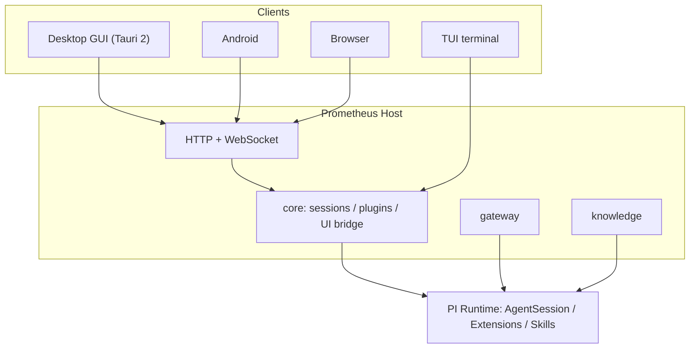

<div align="center">


# Prometheus

**Foresight, handed to you as a spark.**
An open-source, fork-friendly AI agent workbench: one kernel, four entry points — terminal / desktop / web / Android.

[](https://github.com/Mouseww/Prometheus/stargazers)
[](https://github.com/Mouseww/Prometheus/releases)
[](https://github.com/Mouseww/Prometheus/issues)
[](LICENSE)
[](#quick-start)

[Quick start](#quick-start) · [Features](#features) · [Architecture](#architecture) · [Write a plugin](#write-a-plugin) · [Deployment](docs/en/deployment.md) · [Architecture doc](docs/en/architecture.md) · [中文](README.md)


</div>

---

## Why Prometheus

Built on the [PI Agent](https://github.com/earendil-works/pi) runtime. We do not rewrite the agent loop — we spend the effort on being pleasant to use and easy to extend.

| | |
| --- | --- |
| **One kernel, four entry points** | TUI, desktop GUI (Tauri), web and Android share the same server and the same wire protocol, so a session continues anywhere. |
| **Any model you like** | Custom AI gateways: OpenAI Chat / Responses, Anthropic and Gemini protocols, with your own base URL, auth header and key. |
| **Everything is a plugin** | Gateways, knowledge bases, tools, commands, HTTP routes and UI panels are all contributed through `definePlugin` — even the built-in features are plugins. |
| **Permissions you control** | Writing files and running commands ask for confirmation first, with “always allow” per command; third-party credentials are encrypted at rest and never enter the model context. |
| **Anywhere** | One-command deployment to a server, reachable from a browser or phone; LAN / domain access is protected by a password and rate limiting. |

## Features

### Chat and tool calls

Streaming output, Markdown / tables / syntax highlighting, expandable tool-call traces, image input, voice input, a context-usage gauge, plus session branching and rollback.


### Ask before writing or running

In the default mode, writing files and running commands request your confirmation, showing exactly what will be written or executed.

<div align="center">

</div>

### AI gateways: plug in any compatible endpoint

Add a gateway in settings to use your own proxy, a relay, or an official endpoint. Model lists, context windows and pricing are all configurable.


### Skills and plugins

- **Skills**: `SKILL.md`-compatible. The model loads them on demand based on the description, or you can invoke one manually with `/skill:name`. A built-in `prometheus` skill teaches the model about this app.
- **Prometheus plugins**: knowledge base (LanceDB vector search), MCP management, memory, todo, Git, automation, voice, terminal, workbench, SSH, Veil, modes, connectors and more are all delivered as plugins and can be disabled individually.
- **PI plugin marketplace**: install community PI extension packages directly.


### Chat experience

- **Edit and resend**: modify a sent message and resend it; edit or withdraw queued / steered messages.
- **Auto-folded steps**: once a turn finishes, intermediate tool calls fold away and only the final reply stays visible.
- **`@` file mentions**: search and reference workspace files from the composer.
- Adjustable chat width; links open in your default browser, with a context menu to copy.
- **Modes**: Default / Operator / White hat / Purge / Research, each with its own system prompt and tool set; switching does not reload the session.

### Veil: privacy shield

Before a request leaves your machine, secrets (keys, phone numbers, connection strings, ID numbers) are swapped for `{{TYPE_ULID}}` aliases and restored in the reply. If masking fails, the request is blocked rather than sent in clear text. Optional **locale neutralization** and an **egress proxy** (HTTP / HTTPS / SOCKS5) route model traffic through an IP of your choice. See [plugins/veil/README.md](plugins/veil/README.md).

### Git review and branches

Review changes, stage, commit and sync. **Git review** walks through the agent's edits, and the **branch picker** switches branches in place.


### SSH and workbench

- **SSH plugin**: configure remote servers and the agent can run commands and transfer files via `ssh_exec` / `ssh_upload` / `ssh_download`.
- **Workbench**: a side file viewer; the agent can show you a file at a given line with `open_file`.
- **Folder picker**: Explorer-style, can create folders, native dialog on desktop; a default root folder can be set.

### Platforms: one client, many servers

Save several Prometheus servers (this machine, a company server, a home NAS...) and switch between them in one click from Settings or the sidebar, without retyping addresses. Access token or login password are supported (only the session token is kept after sign-in), and the list lives on the current device only. Desktop and Android can switch between local mode and remote servers.

### Desktop and Android

- **Desktop**: closing the window can minimize to the tray so sessions keep running; the tray lists running sessions; in-app update checks also update the local server.
- **Network access**: let LAN devices or a domain (e.g. behind nginx) reach this machine's Prometheus, with password and rate limiting.
- **Android local mode**: the APK bundles Node, npm/npx, git, bash and rg, keeping data on the phone; it can also connect to a remote server.

### And more

| Capability | Description |
| --- | --- |
| Knowledge base | Document chunking and embedding; the agent retrieves autonomously via `knowledge_search`. The vector store is swappable |
| Long-term memory | Remembers preferences, conventions and decisions across sessions; review and delete them in the UI |
| MCP | Manage MCP servers from the UI |
| Connectors | GitHub, Jira / Confluence, Bitbucket, Microsoft 365, databases; OAuth / token auth, with per-connection “read-only / confirm writes / allow writes”. See [connector design](docs/en/connectors.md) |
| Automation | Run agent tasks on a schedule in the background; every run produces a viewable session |
| Sub-agents | Delegate tasks to sub-agents and run them in parallel |
| Themes | Light and dark plus five skins (Ember / Deep Sea / Forest / Nebula / Rose), with Chinese and English UI |
| Usage stats | Token and cost accounting |

## Quick start

Requirements: Node ≥ 22.19 (24 recommended), pnpm 10. The desktop build additionally needs Rust ≥ 1.77 and the [Tauri 2 prerequisites](https://tauri.app/start/prerequisites/).

```bash
git clone https://github.com/Mouseww/Prometheus.git
cd Prometheus
pnpm install
```

| Mode | Command | Notes |
| --- | --- | --- |
| TUI terminal | `pnpm tui` | PI's native interactive UI; loads gateways and plugins automatically |
| Web | `pnpm --filter @prometheus/web build && pnpm dev:server` | Open http://127.0.0.1:7420 |
| Desktop GUI | `pnpm dev:desktop` | Tauri window; starts the local server for you |

On first launch, go to **Settings → AI gateways**, add a model endpoint, and you can start chatting.

### Docker

```bash
docker build -t prometheus .
docker run -p 7420:7420 -e PROMETHEUS_TOKEN=<random string, 16+ chars> \
  -v prometheus-data:/data -v $PWD:/workspace prometheus
```

A token is mandatory when listening on a non-loopback address; for public deployments put it behind an HTTPS reverse proxy. Full details on environment variables, LAN / domain access and the Android build are in [docs/en/deployment.md](docs/en/deployment.md).

## Architecture



```
packages/protocol     wire protocol types
packages/plugin-sdk   plugin SDK (definePlugin)
packages/gateway      AI gateways: OpenAI Chat/Responses, Anthropic, Gemini
packages/knowledge    knowledge service and the knowledge_search tool
packages/core         runtime host (sessions, plugins, UI bridge)
plugins/*             built-in plugins: knowledge, MCP, skills, memory, Git, automation, terminal, connectors…
apps/server           HTTP + WebSocket server
apps/web              React web UI (shared by desktop / Android)
apps/desktop          Tauri desktop shell
apps/cli              TUI entry point
```

See [docs/en/architecture.md](docs/en/architecture.md) for the full design.

## Write a plugin

```ts
import { definePlugin } from "@prometheus/plugin-sdk";

export default definePlugin({
	name: "hello",
	version: "0.1.0",
	setup(ctx) {
		ctx.extension((pi) => {
			pi.registerCommand("hello", { description: "Say hello", handler: async (_args, c) => c.ui.notify("Hello", "info") });
		});
	},
});
```

Drop it into `~/.prometheus/plugins/` or declare the package name in your config. See §11 of the architecture doc.

## Development and verification

```bash
pnpm typecheck
pnpm test
```

Issues and pull requests are welcome.

## License

This project uses the [Prometheus Personal Use License (PPUL) v1.0](LICENSE):

- **Personal use, learning, research**: free; you may modify and self-host.
- **Commercial use** (company business, paid resale, hosted services, embedding into a commercial product, etc.): requires prior authorization — contact the author through the GitHub repository.

Note: because the license restricts commercial use, this is "source-available", not an OSI-approved open-source license.

## Star History

<a href="https://star-history.com/#Mouseww/Prometheus&Date">
  <picture>
    <source media="(prefers-color-scheme: dark)" srcset="https://api.star-history.com/svg?repos=Mouseww/Prometheus&type=Date&theme=dark" />
    <source media="(prefers-color-scheme: light)" srcset="https://api.star-history.com/svg?repos=Mouseww/Prometheus&type=Date" />
    
  </picture>
</a>

<div align="center">

If Prometheus helps you, a star means a lot to us.

**Thanks and kudos to the [LINUX DO](https://linux.do/) community**

</div>
