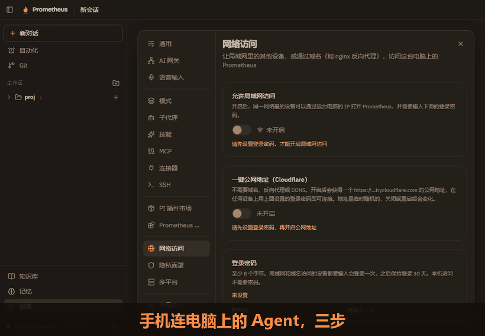
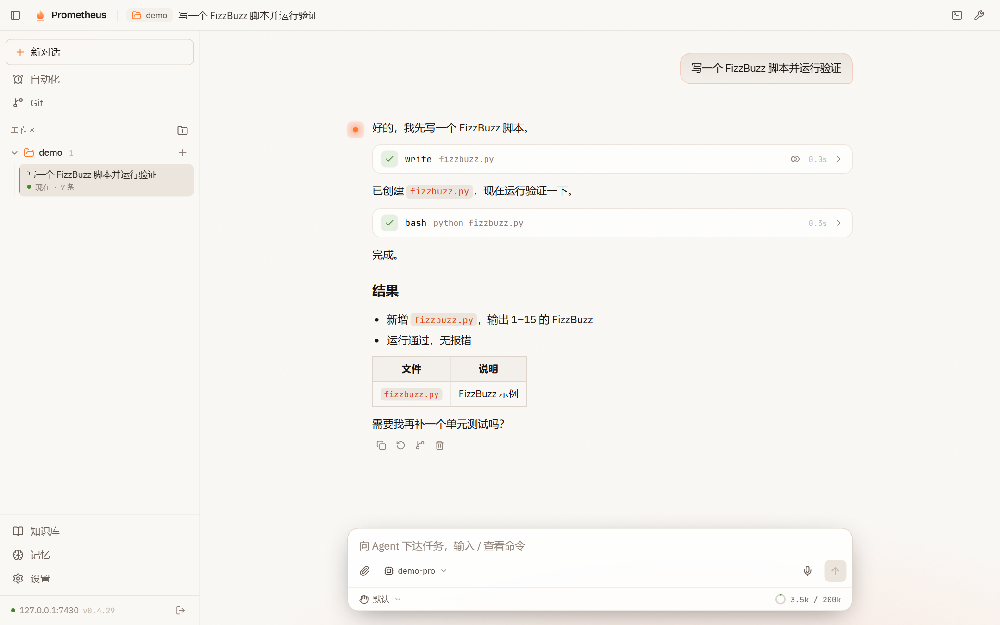
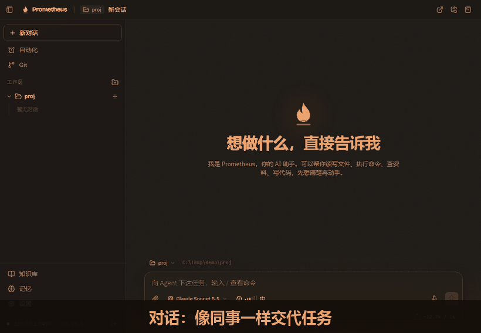
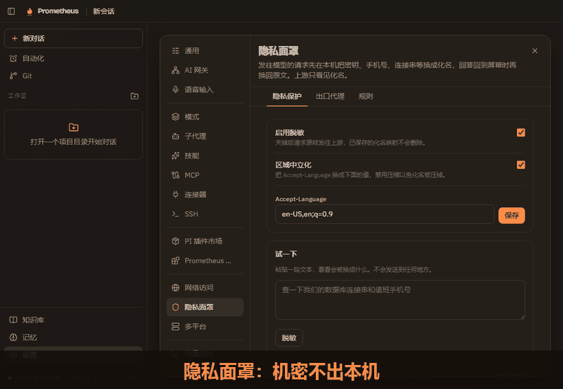
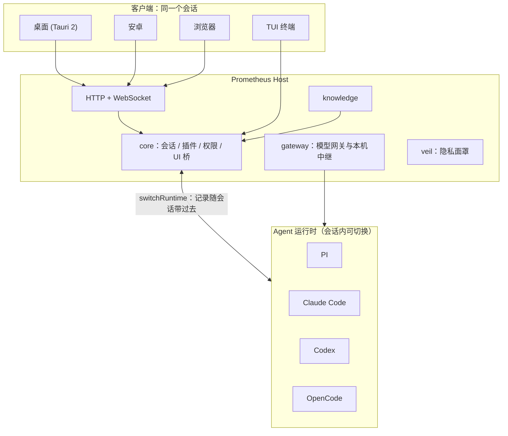

<div align="center">


# Prometheus

**电脑、手机、浏览器、终端，同一个 AI Agent 会话。**

开源、可自托管的 AI Agent 工作台。出门用手机接着电脑里的任务，中途换 Agent 也不用另开会话；写文件前先问你，发给模型前先脱敏。

[](https://github.com/Mouseww/Prometheus/releases)
[](LICENSE)
[](#快速开始)

[快速开始](#快速开始) · [特性](#特性) · [Agent 运行时](#agent-运行时) · [架构](#架构) · [插件](#插件) · [文档](#文档) · [English](README.en.md)



</div>

## 特性

- **跨客户端访问**：TUI、桌面（Tauri）、Web、安卓共用同一套服务端与协议，同一个会话在任意设备上续接。局域网访问带密码和限速，也可一键开启公网地址。
- **会话内无缝切换 Agent**：PI、Claude Code、Codex、OpenCode 共用同一套界面、工具和权限，对话中途可换 Agent，在当前会话里继续，已有记录会带过去。
- **接入任何模型**：OpenAI Chat / Responses、Anthropic、Gemini 四种协议，自定义地址、鉴权头和密钥。
- **先问再做**：写文件、执行命令前展示完整内容并等你确认，可按命令“始终允许”。
- **隐私面罩**：连接串、手机号、密钥在出网前换成化名，回答回来再换回；脱敏失败直接拦截。
- **万物皆插件**：网关、知识库、工具、命令、HTTP 路由、UI 面板都通过 `definePlugin` 贡献。

## 预览



写文件和执行命令前先确认（Claude Sonnet 给函数加类型标注，写入与运行各确认一次）：



隐私面罩在出网前把机密换成化名：



## 快速开始

环境：Node ≥ 22.19（推荐 24）、pnpm 10。桌面版另需 Rust ≥ 1.77 和 [Tauri 2 依赖](https://tauri.app/start/prerequisites/)。

```bash
git clone https://github.com/Mouseww/Prometheus.git
cd Prometheus
pnpm install
```

| 方式 | 命令 | 说明 |
| --- | --- | --- |
| TUI | `pnpm tui` | 终端交互界面 |
| Web | `pnpm --filter @prometheus/web build && pnpm dev:server` | 访问 http://127.0.0.1:7420 |
| 桌面 | `pnpm dev:desktop` | 自动拉起本地服务端 |

首次启动后到 **设置 → AI 网关** 添加一个模型端点，即可开始对话。

### Docker

```bash
docker build -t prometheus .
docker run -p 7420:7420 -e PROMETHEUS_TOKEN=<至少16位随机串> \
  -v prometheus-data:/data -v $PWD:/workspace prometheus
```

> [!IMPORTANT]
> 监听非回环地址必须设置 `PROMETHEUS_TOKEN`。公网部署请放在 HTTPS 反向代理之后。

## Agent 运行时

会话不绑定某个 Agent。输入框下方随时可以换：会话在原位置继续，已有记录作为背景交给新的 Agent，列表里只保留这一个会话。

- 模型选择器列出当前 Agent 能用的全部模型：自带登录的模型，加上每个兼容网关的模型。
- 选自带登录的模型走 Agent 自己的账号，选网关里的模型则经本机中继走该网关。网关密钥只留在 Prometheus。

## 架构



| 目录 | 内容 |
| --- | --- |
| `apps/` | `cli`、`desktop`、`server`、`web` |
| `packages/` | `core`、`protocol`、`gateway`、`knowledge`、`plugin-sdk`、`subagents` |
| `plugins/` | 内置插件：veil、ssh、mcp、git、computer-use 等 |

## 插件

```ts
import { definePlugin } from "@prometheus/plugin-sdk";

export default definePlugin({
  name: "hello",
  setup(ctx) {
    // 注册工具、命令、路由或 UI 面板
  },
});
```

> [!NOTE]
> 上面只是骨架，实际可用的 `ctx` 接口见 `packages/plugin-sdk` 和 [docs/architecture.md](docs/architecture.md)。

## 文档

- [架构](docs/architecture.md)
- [部署](docs/deployment.md)
- [Agent 运行时](docs/agent-runtime.md)
- [连接器](docs/connectors.md)
- [Computer Use](docs/computer-use.md)
