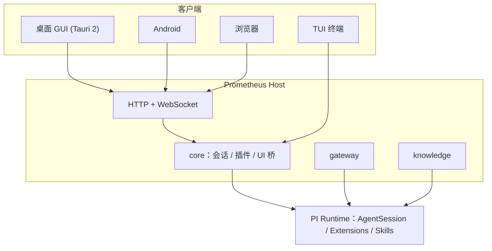

<div align="center">


# Prometheus

**先见之明，递你一簇火。**
一个源码公开、可二次开发的 AI Agent 工作台：同一个内核，终端 / 桌面 / Web / 安卓四种入口。

[](https://github.com/Mouseww/Prometheus/stargazers)
[](https://github.com/Mouseww/Prometheus/releases)
[](https://github.com/Mouseww/Prometheus/issues)
[](LICENSE)
[](#快速开始)

[快速开始](#快速开始) · [功能](#功能一览) · [架构](#架构) · [写一个插件](#写一个插件) · [部署文档](docs/deployment.md) · [架构文档](docs/architecture.md)


</div>

---

## 为什么是 Prometheus

基于 [PI Agent](https://github.com/earendil-works/pi) 运行时，不重写 Agent 循环，把精力放在“好用”和“好扩展”上。

| | |
| --- | --- |
| **一个内核，四个入口** | TUI、桌面 GUI（Tauri）、Web、安卓共用同一套服务端与协议，会话随处可续。 |
| **接入任何模型** | 自定义 AI 网关：OpenAI Chat / Responses、Anthropic、Gemini 四种协议，自定义地址、鉴权头与密钥。 |
| **万物皆插件** | 网关、知识库、工具、命令、HTTP 路由、UI 面板全部通过 `definePlugin` 贡献，连内置功能也是插件。 |
| **可控的权限** | 写文件、执行命令前弹窗确认，可按命令“始终允许”；第三方凭据加密存储，永不进入模型上下文。 |
| **随时随地** | 一键部署到服务器，浏览器、手机直接访问；局域网 / 域名访问带密码与限速保护。 |

## 功能一览

### 对话与工具调用

流式输出、Markdown / 表格 / 代码高亮、工具调用过程可展开查看，支持图片输入、语音输入、上下文用量仪表、会话分支与回滚。


### 写入与命令，先问再做

默认模式下，写文件和执行命令都会先请求你的确认，并展示将要写入的内容或将要执行的命令。

<div align="center">

</div>

### AI 网关：接入任意兼容端点

在设置里添加网关即可使用自建代理、中转或官方端点，模型列表、上下文窗口、价格都可配置。


### 技能与插件

- **Skills**：兼容 `SKILL.md`，模型按描述按需加载，也可用 `/skill:名称` 手动调用；应用自带 `prometheus` 技能让模型了解本应用。
- **Prometheus 插件**：知识库（LanceDB 向量检索）、MCP 管理、记忆、待办、Git、自动化、语音、终端、工作台、连接器等均以插件形式提供，可单独停用。
- **PI 插件市场**：直接安装社区的 PI 扩展包。


### 内置 Git 面板

查看改动、暂存、提交、切换分支与同步，Agent 改完代码可以直接在这里审阅。


### 更多

| 能力 | 说明 |
| --- | --- |
| 知识库 | 文档切分、向量化，Agent 通过 `knowledge_search` 自主检索；向量存储可替换 |
| 长期记忆 | 跨会话记住偏好、约定与决策，可在界面里查看与删除 |
| MCP | 在界面中管理 MCP 服务器 |
| 连接器 | GitHub、Jira / Confluence、Bitbucket、Microsoft 365、数据库；OAuth / 令牌授权，写操作可设“只读 / 写前确认 / 允许写”，详见 [连接器设计](docs/connectors.md) |
| 自动化 | 按计划在后台运行 Agent 任务，每次运行都生成可查看的会话 |
| 子 Agent | 把任务委派给子 Agent 并行处理 |
| 多皮肤 | 深浅主题 + 余烬 / 深海 / 森林 / 星云 / 玫瑰 五种皮肤，中英文界面 |
| 用量统计 | 查看 token 与费用用量 |

## 快速开始

环境：Node ≥ 22.19（推荐 24）、pnpm 10。桌面版另需 Rust ≥ 1.77 与 [Tauri 2 依赖](https://tauri.app/start/prerequisites/)。

```bash
git clone https://github.com/Mouseww/Prometheus.git
cd Prometheus
pnpm install
```

| 方式 | 命令 | 说明 |
| --- | --- | --- |
| TUI 终端 | `pnpm tui` | PI 原生交互界面，自动加载网关与插件 |
| Web | `pnpm --filter @prometheus/web build && pnpm dev:server` | 访问 http://127.0.0.1:7420 |
| 桌面 GUI | `pnpm dev:desktop` | Tauri 窗口，自动拉起本地服务端 |

首次启动后到 **设置 → AI 网关** 添加一个模型端点，就可以开始对话了。

### Docker 部署

```bash
docker build -t prometheus .
docker run -p 7420:7420 -e PROMETHEUS_TOKEN=<至少16位随机串> \
  -v prometheus-data:/data -v $PWD:/workspace prometheus
```

非回环地址监听必须设置令牌；公网部署请置于 HTTPS 反向代理之后。环境变量、局域网 / 域名访问、安卓版等完整说明见 [docs/deployment.md](docs/deployment.md)。

## 架构



```
packages/protocol     线协议类型
packages/plugin-sdk   插件开发 SDK（definePlugin）
packages/gateway      AI 网关：OpenAI Chat/Responses、Anthropic、Gemini
packages/knowledge    知识库服务与 knowledge_search 工具
packages/core         运行时宿主（会话、插件、UI 桥）
plugins/*             内置插件：知识库、MCP、技能、记忆、Git、自动化、终端、连接器…
apps/server           HTTP + WebSocket 服务端
apps/web              React Web UI（桌面 / 安卓共用）
apps/desktop          Tauri 桌面壳
apps/cli              TUI 入口
```

完整设计见 [docs/architecture.md](docs/architecture.md)。

## 写一个插件

```ts
import { definePlugin } from "@prometheus/plugin-sdk";

export default definePlugin({
	name: "hello",
	version: "0.1.0",
	setup(ctx) {
		ctx.extension((pi) => {
			pi.registerCommand("hello", { description: "打招呼", handler: async (_args, c) => c.ui.notify("你好", "info") });
		});
	},
});
```

放入 `~/.prometheus/plugins/` 或在配置中声明包名即可加载，详见架构文档 §11。

## 开发与验证

```bash
pnpm typecheck
pnpm test
```

欢迎提交 Issue 与 PR。

## 许可证

本项目采用 [Prometheus Personal Use License (PPUL) v1.0](LICENSE)：

- **个人使用、学习、研究**：免费，可修改与自行部署。
- **商业使用**（公司业务、收费出售、对外提供托管服务、集成进商业产品等）：需事先获得授权，请通过 GitHub 仓库联系作者。

注意：该许可证限制商业使用，属于“源码公开”，不是 OSI 定义的开源许可证。

## Star History

<a href="https://star-history.com/#Mouseww/Prometheus&Date">
  <picture>
    <source media="(prefers-color-scheme: dark)" srcset="https://api.star-history.com/svg?repos=Mouseww/Prometheus&type=Date&theme=dark" />
    <source media="(prefers-color-scheme: light)" srcset="https://api.star-history.com/svg?repos=Mouseww/Prometheus&type=Date" />
    
  </picture>
</a>

<div align="center">

如果 Prometheus 对你有帮助，欢迎点一个 Star，这是对我们最大的鼓励。

**感谢并认可 [LINUX DO](https://linux.do/) 社区**

</div>
