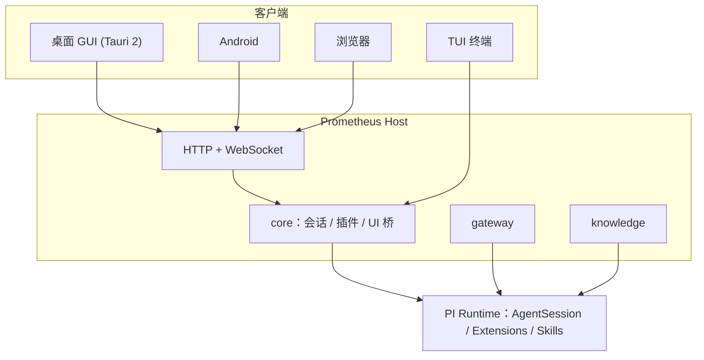

<div align="center">


# Prometheus

**在手机上指挥你电脑里的 AI Agent，机密不出本机。**
开源、可自托管的 AI Agent 工作台：接任意模型网关，写文件前先问你，发给模型前先脱敏；电脑、手机、浏览器、终端共用同一个会话。

[](https://github.com/Mouseww/Prometheus/stargazers)
[](https://github.com/Mouseww/Prometheus/releases)
[](https://github.com/Mouseww/Prometheus/issues)
[](LICENSE)
[](#快速开始)

[快速开始](#快速开始) · [功能](#功能一览) · [隐私面罩](#隐私面罩veil) · [架构](#架构) · [写一个插件](#写一个插件) · [部署文档](docs/deployment.md) · [架构文档](docs/architecture.md) · [English](README.en.md)


</div>

---

## 三个场景

**1. 出门在外，手机接着电脑里的任务。** 在电脑上设置登录密码、打开局域网访问（或一键开启 Cloudflare 公网地址，不用配域名、反代和 DDNS），手机在连接页点「扫码」或输入地址，就能继续同一个会话。

**2. 先问你，再动手。** 写文件、执行命令之前会展示完整内容并等你确认，可以按命令“始终允许”。下面是真实录屏：让 Claude Sonnet 给函数加类型标注，写入与运行各确认一次。

<div align="center"></div>

**3. 机密不出本机。** 数据库连接串、手机号、密钥在发给模型之前换成化名，回答回来再换回原文；脱敏失败直接拦截。

<div align="center"></div>

---

## 为什么是 Prometheus

基于 [PI Agent](https://github.com/earendil-works/pi) 运行时，不重写 Agent 循环，把精力放在“好用”和“好扩展”上。

| | |
| --- | --- |
| **一个内核，四个入口** | TUI、桌面 GUI（Tauri，Windows / macOS Intel 与 Apple 芯片，内置 Node 与 npm/npx）、Web、安卓共用同一套服务端与协议，会话随处可续。 |
| **接入任何模型** | 自定义 AI 网关：OpenAI Chat / Responses、Anthropic、Gemini 四种协议，自定义地址、鉴权头与密钥。 |
| **万物皆插件** | 网关、知识库、工具、命令、HTTP 路由、UI 面板全部通过 `definePlugin` 贡献，连内置功能也是插件。 |
| **隐私优先** | 隐私面罩在出网前脱敏机密，并可经指定代理出口。 |
| **可控的权限** | 写文件、执行命令前弹窗确认，可按命令“始终允许”；第三方凭据加密存储，永不进入模型上下文。 |
| **随时随地** | 一键部署到服务器，浏览器、手机直接访问；局域网 / 域名访问带密码与限速保护。 |

## 功能一览

### 对话与工具调用

流式输出、Markdown / 表格 / 代码高亮、工具调用过程可展开查看，支持图片输入、语音输入、上下文用量仪表、会话分支与回滚。


### 写入与命令，先问再做

默认模式下，写文件和执行命令都会先请求你的确认，并展示将要写入的内容或将要执行的命令。

<div align="center">

</div>

### AI 网关：接入任意兼容端点

在设置里添加网关即可使用自建代理、中转或官方端点，模型列表、上下文窗口、价格都可配置。


### 技能与插件

- **Skills**：兼容 `SKILL.md`，模型按描述按需加载，也可用 `/skill:名称` 手动调用；应用自带 `prometheus` 技能让模型了解本应用。
- **Prometheus 插件**：知识库（LanceDB 向量检索）、MCP 管理、记忆、待办、Git、自动化、语音、终端、工作台、连接器等均以插件形式提供，可单独停用。
- **PI 插件市场**：直接安装社区的 PI 扩展包。


### 对话体验

- **编辑并重发**：已发送的消息可修改后重发；排队 / 引导中的消息可编辑或撤回。
- **自动折叠步骤**：一轮结束后，中间的工具调用自动折叠，只留最终回复，长对话更清爽。
- **`@` 文件提及**：输入框里 `@` 搜索工作区文件并引用。
- **对话宽度**可调；链接用系统默认浏览器打开，右键菜单可复制。
- **子代理（Subagents）**：在「设置 → 子代理」里配置内置与自定义子代理的说明、提示词模式、提示词、模型、工具与上下文限制；自带子代理运行时，支持并行与后台任务，每个子代理可选由 PI、Claude Code 或 Codex 命令行执行；「子代理增强」模式会让主代理优先把任务委派给子代理。
- **模式（Modes）**：默认 / 子代理增强 / 运维 / 白帽 / 净化 / 调研等模式，各自拥有独立的系统提示词与工具集，切换无需重载会话。

### 隐私面罩（Veil）

出网前把密钥、手机号、连接串、证件号等机密换成 `{{类型_ULID}}` 化名，回答回来再换回原文；脱敏失败直接拦截，绝不外发明文。另可开启**区域中立化**与**出口代理**（HTTP / HTTPS / SOCKS5），让模型请求从指定 IP 出去。详见 [plugins/veil/README.md](plugins/veil/README.md)。

### Git 审阅与分支

查看改动、暂存、提交、同步；**Git 审阅**可逐处审阅 Agent 的改动，**分支选择器**随时切换分支。


### SSH 远程与工作台

- **SSH 插件**：配置远程服务器后，Agent 可通过 `ssh_exec` / `ssh_upload` / `ssh_download` 在远端执行命令、传输文件。
- **工作台**：侧边文件查看器，Agent 可用 `open_file` 直接把文件定位到指定行给你看。
- **文件夹选择器**：资源管理器风格，可新建文件夹，桌面版使用原生对话框；可设置默认根目录。

### 多平台：一个客户端连多个服务

保存多台 Prometheus 服务（本机、公司服务器、家里的 NAS……），在设置或侧边栏一键切换要连接的那一个，不用重复输入地址。支持访问令牌或登录密码，登录后保存会话令牌；添加时可勾选「记住密码」，切换平台自动登录（密码明文存于本机，默认勾选，可取消）。平台列表只存在当前设备。桌面版与安卓版都可以在「本机模式」与远程服务之间切换。

### 桌面与安卓

- **桌面**：关闭窗口可最小化到托盘，会话在后台继续运行；托盘可查看运行中的会话；应用内检查并一键更新（同时更新本机服务端）。
- **网络访问**：让局域网设备或通过域名（如 nginx 反代）访问本机的 Prometheus，带密码与限速。
- **一键公网地址**：不会配域名反代和 DDNS 也能连：在「设置 → 网络访问」打开 Cloudflare 临时隧道，获得一个 `https://xxxx.trycloudflare.com` 地址（首次自动下载 cloudflared，需先设置登录密码，地址随机且重启后会变，网络受限时会提示检查网络或代理）。
- **扫码连接**：网络访问页对局域网 / 公网地址显示二维码，手机端连接页点「扫码」即可填入地址（安卓会申请相机权限）。
- **完成通知**：在「设置 → 通用 → 通知」开启后，每轮对话结束时通过系统通知提醒（Windows / macOS / 安卓 / 浏览器），可选仅在后台时通知。
- **安卓本机模式**：APK 内置 Node、npm/npx、git、bash、rg，数据留在手机上；也可以连接远程服务器。

### 更多

| 能力 | 说明 |
| --- | --- |
| 知识库 | 文档切分、向量化，Agent 通过 `knowledge_search` 自主检索；向量存储可替换 |
| 长期记忆 | 跨会话记住偏好、约定与决策，可在界面里查看与删除 |
| MCP | 在界面中管理 MCP 服务器 |
| 连接器 | GitHub、Jira / Confluence、Bitbucket、Microsoft 365、数据库；OAuth / 令牌授权，写操作可设“只读 / 写前确认 / 允许写”，详见 [连接器设计](docs/connectors.md) |
| 自动化 | 按计划在后台运行 Agent 任务，每次运行都生成可查看的会话 |
| 子 Agent | 把任务委派给子 Agent 并行处理 |
| 终端 | 内置终端面板 |
| 语音 | 语音输入 |
| PI 配置导入 | 网关默认值与一键导入已有 PI 配置 |
| 系统通知 | 任务完成时按平台调用系统通知，首次开启请求权限，可随时关闭 |
| 多皮肤 | 深浅主题 + 余烬 / 深海 / 森林 / 星云 / 玫瑰 五种皮肤，中英文界面 |
| 用量统计 | 查看 token 与费用用量 |

## 快速开始

环境：Node ≥ 22.19（推荐 24）、pnpm 10。桌面版另需 Rust ≥ 1.77 与 [Tauri 2 依赖](https://tauri.app/start/prerequisites/)。

```bash
git clone https://github.com/Mouseww/Prometheus.git
cd Prometheus
pnpm install
```

| 方式 | 命令 | 说明 |
| --- | --- | --- |
| TUI 终端 | `pnpm tui` | PI 原生交互界面，自动加载网关与插件 |
| Web | `pnpm --filter @prometheus/web build && pnpm dev:server` | 访问 http://127.0.0.1:7420 |
| 桌面 GUI | `pnpm dev:desktop` | Tauri 窗口，自动拉起本地服务端 |

首次启动后到 **设置 → AI 网关** 添加一个模型端点，就可以开始对话了。

### Docker 部署

```bash
docker build -t prometheus .
docker run -p 7420:7420 -e PROMETHEUS_TOKEN=<至少16位随机串> \
  -v prometheus-data:/data -v $PWD:/workspace prometheus
```

非回环地址监听必须设置令牌；公网部署请置于 HTTPS 反向代理之后。环境变量、局域网 / 域名访问、安卓版等完整说明见 [docs/deployment.md](docs/deployment.md)。

## 架构



```
packages/protocol     线协议类型
packages/plugin-sdk   插件开发 SDK（definePlugin）
packages/gateway      AI 网关：OpenAI Chat/Responses、Anthropic、Gemini
packages/knowledge    知识库服务与 knowledge_search 工具
packages/core         运行时宿主（会话、插件、UI 桥）
plugins/*             内置插件：知识库、MCP、技能、记忆、Git、自动化、终端、SSH、隐私面罩、模式、连接器…
apps/server           HTTP + WebSocket 服务端
apps/web              React Web UI（桌面 / 安卓共用）
apps/desktop          Tauri 桌面壳
apps/cli              TUI 入口
```

完整设计见 [docs/architecture.md](docs/architecture.md)（英文版：[docs/en/architecture.md](docs/en/architecture.md)）。

## 写一个插件

```ts
import { definePlugin } from "@prometheus/plugin-sdk";

export default definePlugin({
	name: "hello",
	version: "0.1.0",
	setup(ctx) {
		ctx.extension((pi) => {
			pi.registerCommand("hello", { description: "打招呼", handler: async (_args, c) => c.ui.notify("你好", "info") });
		});
	},
});
```

放入 `~/.prometheus/plugins/` 或在配置中声明包名即可加载，详见架构文档 §11。

## 开发与验证

```bash
pnpm typecheck
pnpm test
```

欢迎提交 Issue 与 PR。

## 许可证

本项目采用 [GNU AGPL-3.0](LICENSE) 开源许可证：

- 个人、组织、公司均可使用、修改、自行部署。
- 二次开发须保留版权与许可证声明、标注修改；分发或通过网络对外提供修改版本时，须以 AGPL-3.0 公开对应的完整源码。

## Star History

<a href="https://star-history.com/#Mouseww/Prometheus&Date">
  <picture>
    <source media="(prefers-color-scheme: dark)" srcset="https://api.star-history.com/svg?repos=Mouseww/Prometheus&type=Date&theme=dark" />
    <source media="(prefers-color-scheme: light)" srcset="https://api.star-history.com/svg?repos=Mouseww/Prometheus&type=Date" />
    
  </picture>
</a>

<div align="center">

如果 Prometheus 对你有帮助，欢迎点一个 Star，这是对我们最大的鼓励。

**感谢并认可 [LINUX DO](https://linux.do/) 社区**

</div>
