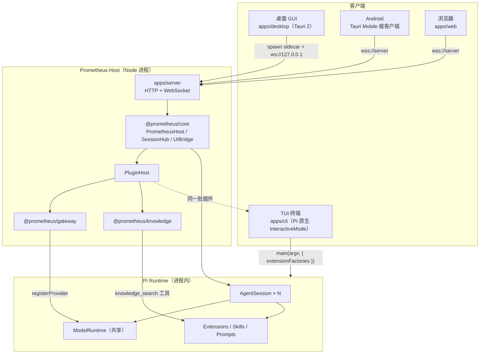
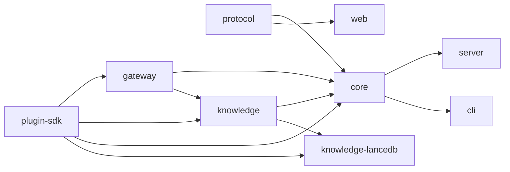
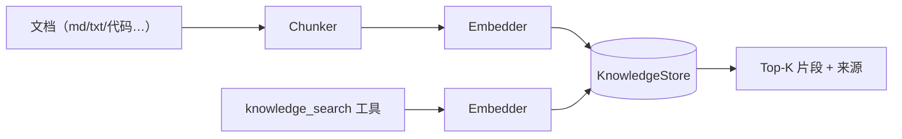

# Prometheus 架构设计

> English: [docs/en/architecture.md](en/architecture.md)

> 基于 PI Agent 的高性能、高颜值、插件化 Agent 框架。任何人都可以在其上快速二次开发自己的 Agent。

- 版本：v0.1（骨架）
- PI 基线：`@earendil-works/pi-coding-agent@1.2.0`（Node ≥ 22.19，ESM）

---

## 1. 设计目标

| # | 需求 | 方案 |
|---|------|------|
| 1 | Runtime 核心为 PI Agent | 进程内嵌 PI SDK（`createAgentSession`），不 fork、不重写 agent loop |
| 2 | Windows / macOS / Linux / Android | 桌面三端：Tauri 2 + Node sidecar；Android：Tauri 2 Mobile 瘦客户端连接 Server |
| 3 | TUI + GUI | TUI 直接复用 PI 原生 `main()`，注入 Prometheus 插件；GUI = Tauri 壳 + 同一套 Web UI |
| 4 | 知识库 | `@prometheus/knowledge` 定义 Store/Embedder 抽象，默认 LanceDB 插件，可替换为 Qdrant/pgvector |
| 5 | 自定义 AI 网关 | `@prometheus/gateway`：四种协议 × 多种鉴权，编译为 PI `ProviderConfig` |
| 6 | 服务器部署 + Web 访问 | `apps/server`：HTTP + WebSocket，同时托管 Web UI 静态资源 |
| 7 | 万物皆插件 | 网关、知识库、工具、命令、HTTP 路由、UI 面板全部通过 `definePlugin` 贡献 |
| 8 | PI 全能力 UI 化 | 统一线协议 `@prometheus/protocol` 映射 PI 的全部会话事件与命令（见 §7 能力矩阵） |

**非目标**：不实现自己的 LLM 抽象层（复用 `pi-ai`）。

---

## 2. 总体架构



关键点：

1. **同一套插件，三种宿主**。插件通过 `ctx.extension(factory)` 贡献 PI 扩展，TUI（PI `main()`）与 Server（`DefaultResourceLoader`）都能加载，行为一致。
2. **一个 Host 进程，多个会话**。`SessionHub` 持有多个 `AgentSession`，共享一个 `ModelRuntime`（网关修改即时生效）。
3. **UI 只认线协议**。Web、桌面、Android 是同一份 React 产物，差别仅在“如何发现后端地址”。

---

## 3. 仓库结构（pnpm monorepo）

```
prometheus/
├─ packages/
│  ├─ protocol/        线协议类型（零依赖，前后端共享）
│  ├─ plugin-sdk/      definePlugin / PluginContext 契约
│  ├─ gateway/         AI 网关：配置 schema、鉴权、→ PI ProviderConfig
│  ├─ knowledge/       知识库抽象：Chunker / Embedder / KnowledgeStore / 检索工具
│  └─ core/            PrometheusHost：配置、插件宿主、SessionHub、扩展 UI 桥
├─ plugins/
│  └─ knowledge-lancedb/   默认向量存储
├─ apps/
│  ├─ server/          Node HTTP/WS 服务（亦作为桌面 sidecar）
│  ├─ cli/             `prometheus` TUI（PI 原生）
│  ├─ web/             React 19 + Vite + Tailwind v4 UI
│  └─ desktop/         Tauri 2 壳（桌面 + Android）
└─ docs/
```

依赖方向（严格单向）：



---

## 4. 插件系统（万物皆插件）

### 4.1 契约

```ts
export default definePlugin({
  name: "my-plugin",
  setup(ctx) {
    ctx.extension((pi) => {            // ① PI 扩展：工具 / 命令 / Provider / 生命周期钩子
      pi.registerTool({ ... });
      pi.registerCommand("hello", { handler: async (_args, c) => c.ui.notify("hi") });
    });
    ctx.knowledgeStore("qdrant", (opts) => new QdrantStore(opts)); // ② 知识库后端
    ctx.route("GET", "/status", (req, res) => { ... });              // ③ HTTP 路由（仅 Server）
    ctx.panel({ id: "dash", title: "仪表盘", path: "/index.html" }); // ④ UI 面板（iframe）
    ctx.rpc("stats", async (params) => ({ ... }));                  // ⑤ RPC：客户端经 plugin.call 调用
    await ctx.reloadSessions();                                      // ⑥ 资源变更后热重载活动会话
  },
});
```

| 贡献点 | TUI | Server/GUI | 说明 |
|--------|:---:|:---:|------|
| `extension` | ✅ | ✅ | 完整 PI ExtensionAPI，所有 PI 生态扩展可直接复用 |
| `knowledgeStore` | ✅ | ✅ | 按 id 注册，知识库创建时选择 |
| `route` | — | ✅ | 挂载到 `/plugins/<name>/<path>` |
| `panel` | — | ✅ | Web UI 侧边栏出现入口，iframe 加载插件路由 |
| `rpc` | — | ✅ | `plugin.call({plugin, method, params})`；参数来自客户端，必须校验 |
| `reloadSessions` | — | ✅ | 空闲会话立即 `session.reload()`，运行中的在 settle 后重载 |

SDK 还提供 `createJsonStore(path, fallback)`：原子写、串行化、权限 0600，读取不缓存，便于 TUI 与 Server 共享同一文件。

### 4.2 发现与加载

1. 内置插件：knowledge、`plugins/builtin` 聚合的 knowledge-lancedb / mcp / skills / memory
2. `config.json` 中 `plugins: ["npm-包名", "./本地路径"]`
3. `<dataDir>/plugins/*/`（含 `package.json` 的目录）

加载使用 `import(pathToFileURL(entry))`，每个插件 `setup` 独立 try/catch，失败只记录诊断，不影响宿主。

Server 侧与 TUI 一致地加载 PI 的内置扩展（MCP 客户端、codemode、tool-search），且先于插件扩展。

### 4.3 内置管理插件

三者都是普通插件，可作为二次开发模板；数据位于 `<dataDir>/plugin-data/<name>/`。

| 插件 | 接入 PI 的方式 | RPC | UI |
|------|---------------|-----|----|
| `mcp` | `pi.registerMcpServer()` 交给 PI 内置 MCP 扩展连接（OAuth、exposure、codemode 均复用 PI）；另只读展示 PI 自己的 `mcp.json` | list / save / toggle / delete / probe（用 pi-mcp 客户端即时连接并列出工具） | MCP 页：stdio/HTTP、env/headers（密钥脱敏回显）、测试连接 |
| `skills` | `resources_discover` 返回启用技能的目录，与 PI 自带的 `~/.pi/agent/skills`、`.pi/skills` 合并 | list / get / create / save / toggle / delete | 技能页：按来源分组，SKILL.md 编辑器 |
| `memory` | 工具 `memory_save` / `memory_search` / `memory_forget`；`before_agent_start` 按相关度注入置顶 + 命中记忆（≤ 8 条 / 3000 字） | list / add / update / delete / settings | 记忆页：全局/项目作用域、置顶、标签、批量删除、自动注入开关 |

记忆检索为零依赖的词项匹配（拉丁词 + CJK 二元组），足够应对数千条规模；需要语义召回时可以用插件替换为向量实现。注入段落明确标注“视为上下文而非指令”，降低被污染记忆影响。

> **安全**：插件与 PI 扩展都是受信代码，运行在宿主进程内，拥有宿主进程的全部权限。只安装可信来源的插件。

---

## 5. AI 网关

### 5.1 配置模型

```jsonc
{
  "id": "my-claude",                 // 即 PI providerId
  "name": "公司 Claude 网关",
  "format": "anthropic-messages",    // openai-completions | openai-responses | anthropic-messages | google-generative-ai
  "baseUrl": "https://llm.example.com/anthropic",
  "auth": { "type": "header", "header": "X-Api-Key", "prefix": "" },
  "apiKey": "sk-...",                // 落盘 0600，接口返回时脱敏
  "headers": { "X-Team": "ai" },
  "models": [{ "id": "claude-sonnet-5", "contextWindow": 200000, "maxTokens": 64000, "reasoning": true, "vision": true }]
}
```

### 5.2 鉴权类型

| type | 行为 |
|------|------|
| `native` | 交给协议原生方式（OpenAI `Authorization: Bearer`；Anthropic `x-api-key`；Gemini `x-goog-api-key`） |
| `bearer` | 强制 `Authorization: Bearer <token>` |
| `header` | 自定义头名与前缀，例如头名 `api-key`、无前缀（Azure 风格） |
| `none` | 不鉴权（本地 Ollama / vLLM） |

### 5.3 编译到 PI

`toProviderConfig(gateway)` 产出 `ProviderConfig`：`api = format`、`baseUrl`、`apiKey`、`headers`（合并自定义鉴权头）、`authHeader`（bearer 模式）、`models`（补齐 PI 必需字段：`name`、`input`、`cost`、`reasoning`、`contextWindow`、`maxTokens`）。`anthropic-messages` 网关会去掉末尾 `/v1`（Anthropic SDK 自己拼 `/v1/messages`，重复会 404）；Claude 5 / Sonnet 4.6 / Opus 4.6+ / Haiku 5 / Fable 5 会自动带上 `compat.forceAdaptiveThinking` 和 `thinkingLevelMap.off = null`，否则 PI 会发 `thinking.type=enabled` 或 `disabled`，上游会 400。

- Server：`modelRuntime.registerProvider(id, cfg)`，修改即时生效，`unregisterProvider` 删除。
- TUI：同一配置通过扩展 `pi.registerProvider(id, cfg)` 注入。

PI 自带的 Provider（`/login` 登录的 Anthropic/OpenAI/Gemini 等）保持可用，网关是叠加关系。

---

## 6. 知识库



- **Chunker**：按 Markdown 标题/段落递归切分，默认 800 字符、重叠 120。
- **Embedder**：复用网关配置。OpenAI 两种格式走 `POST {baseUrl}/embeddings`；Gemini 走 `:batchEmbedContents`；Anthropic 无嵌入接口，需另选网关。
- **KnowledgeStore**：`upsert / search / deleteDocument / listDocuments / drop`。默认 `lancedb`，插件可注册 `qdrant`、`pgvector` 等。
- **Agent 接入**：以 PI 工具 `knowledge_search` 暴露（TypeBox schema），并在系统提示中注入可用知识库清单，由模型自主决定何时检索。TUI 同样可用。
- 解析器扩展点（PDF/Docx/网页）后续通过插件贡献，v0.1 支持纯文本类。

---

## 7. PI 能力 → UI 能力矩阵

| PI 能力 | PI API | 线协议 | UI | 阶段 |
|--------|--------|--------|----|:---:|
| 流式对话（文本/思考） | `prompt` + `message_update` | `chat.prompt` / `event` | 消息流、思考折叠块 | v0.1 |
| 工具调用实时展示 | `tool_execution_*` | `event` | 工具卡片（参数/进度/结果/耗时） | v0.1 |
| 中断 | `abort` | `chat.abort` | 停止按钮 / Esc | v0.1 |
| Steering / Follow-up 队列 | `prompt({streamingBehavior})`、`queue_update` | `chat.prompt{delivery}` | 运行中输入时选择插队/排队，队列条 | v0.1 |
| 模型切换 | `setModel`、`modelRuntime.getAvailable` | `model.list/set` | 模型选择器（按 Provider 分组） | v0.1 |
| 思考等级 | `setThinkingLevel`、`getAvailableThinkingLevels` | `thinking.set` | 等级分段控件 | v0.1 |
| 会话管理 | `SessionManager.list/create/open` | `session.*` | 会话侧栏：新建/切换/重命名 | v0.1 |
| 斜杠命令 / 提示模板 / Skills | `extensionRunner.getRegisteredCommands`、`promptTemplates`、`getSkills` | `commands.list` | `/` 命令面板 | v0.1 |
| 扩展 UI（select/confirm/input/editor/notify/status/widget/title） | `bindExtensions({uiContext})` | `ui.request` / `ui.respond` | 模态对话框、Toast、状态栏、Widget 区 | v0.1 |
| 上下文用量、构成与手动压缩 | `getContextUsage`、`getSessionStats`、`compact` | `session.stats`、`chat.compact` | 输入框底栏用量环，点击展开构成项与压缩按钮 | v0.1 |
| 工具启用/禁用 | `getAllTools`、`setActiveToolsByName` | `tools.list/set` | 标题栏工具开关 | v0.1 |
| 手动压缩 | `compact`、`compaction_*` | `chat.compact` | 压缩按钮 + 进度提示 | v0.1 |
| 自动重试 | `auto_retry_*` | `event` | 重试横幅 | v0.1 |
| `!` Bash 执行 | `executeBash`、`bash_execution_update` | `bash.run` | 终端输出块 | v0.2 |
| 会话树 / 分叉 / 回溯 | `getTree`、`navigateTree`、`SessionManager.forkFrom` | `session.tree/fork/navigate` | 分支树视图 | v0.2 |
| 导出 HTML | `exportToHtml` | `session.export` | 导出按钮 | v0.2 |
| 扩展/Skills/主题管理、热重载 | `reload`、ResourceLoader | `resources.*` | 资源管理页 | v0.2 |
| PI `/login` OAuth | `ModelRuntime` auth | `auth.*` | 登录向导 | v0.3 |
| `custom()` TUI 组件 | 仅 TUI | — | 降级为通知；插件改用 `panel` | — |

---

## 8. 线协议（WebSocket）

单连接、JSON 文本帧。所有类型定义在 `@prometheus/protocol`。

```ts
// Client → Server
{ id: "r1", type: "chat.prompt", sessionId, text, delivery?: "steer" | "followUp" }
// Server → Client
{ type: "response", id: "r1", ok: true, data }
{ type: "event", sessionId, event }        // 已瘦身的 PI AgentSessionEvent
{ type: "ui.request", sessionId, request } // 扩展 UI 请求
```

- **鉴权**：连接后第一帧必须是 `auth`（5 秒超时）；令牌采用常量时间比较。令牌不放在 URL 中，避免进入访问日志。
- **事件瘦身**：去掉 `message_update.partial`（每个 delta 都会携带完整消息，O(n²) 流量），客户端按 `contentIndex` 增量重建，`message_end` 再做一次权威校准。
- **多客户端**：同一会话可被多个客户端订阅，事件广播；扩展 UI 请求由任一客户端应答，应答后向其他客户端广播 `ui.resolved`。

---

## 9. 平台与部署

| 平台 | 形态 | 后端发现 |
|------|------|---------|
| Windows / macOS / Linux | Tauri 2 壳 + `prometheus-server` sidecar（Node SEA 单文件） | Rust 选取空闲端口并生成随机令牌，通过 `backend_info` 命令传给 WebView |
| Android | Tauri 2 Mobile；APK 内置 Node（取自 Termux）与服务端 tarball，首次启动解压到应用私有目录，Rust 以子进程方式拉起，与桌面同一套握手 | 连接页可选「本机模式」或「连接服务器」；向量库（LanceDB）无 Android 原生绑定，本机模式下不可用 |
| 服务器 | `node apps/server/dist/main.js` 或 Docker | 同源访问 |
| 终端 | `prometheus` CLI（PI 原生 TUI） | 进程内 |

### 服务器部署安全基线

- 默认只监听 `127.0.0.1`；监听非回环地址时**必须**设置 `PROMETHEUS_TOKEN`，否则拒绝启动。
- PI 自带 `bash`/`write` 等工具：**通过鉴权的访问者等同于获得服务器 shell 权限**。公网部署应放在容器或沙箱中（参考 PI containerization 文档），并在前面加 TLS 反向代理。
- API Key 落盘权限为 0600，任何接口都不回传明文。
- 静态文件服务做路径规范化，防止目录穿越。

---

## 10. 性能要点

- 事件瘦身 + 16ms 帧合并渲染（前端 `requestAnimationFrame` 批处理 delta）。
- 长消息列表虚拟化（v0.2）。
- 共享 `ModelRuntime`，模型目录只加载一次。
- Tauri 2 包体约为 Electron 的 1/10；Node sidecar 按需启动。
- LanceDB 嵌入式列存，零外部服务。

---

## 11. 二次开发路径

1. **只写插件**：`definePlugin` 注册工具/命令/面板，放进 `<dataDir>/plugins/`。
2. **定制品牌**：Fork `apps/web` 主题变量（`src/styles.css` 中的 CSS 变量）与 `apps/desktop/tauri.conf.json`。
3. **嵌入式**：在自己的 Node 服务中直接 `new PrometheusHost(options)`，复用会话、网关与知识库。

---

## 12. 路线图

- **v0.1（本次）**：骨架打通。网关 CRUD → 模型选择 → 流式对话 → 工具展示 → 扩展 UI 桥 → 知识库入库/检索 → TUI 复用。
- **v0.2**：会话树/分叉、Bash 块、导出、资源管理、消息虚拟化、Docker 镜像。
- **v0.3**：OAuth 登录向导、多用户与 RBAC、插件市场、Android 发布流水线。
