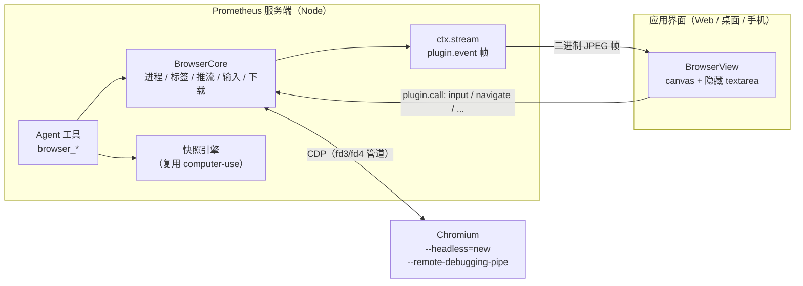

# 内置浏览器插件设计

> 状态：已实现，位于 `plugins/browser`（服务端）与 `apps/web/src/components/browser`（界面）· 目标：做到 Claude Desktop 内置浏览器的体验——Agent 和用户共用一个浏览器，用户在侧边面板里实时看 Agent 操作，随时可以接手——同时绕开 Tauri 子 webview 的层级问题。

---

## 1. 为什么不用 Tauri 的子 webview

Tauri 2 的 `Window::add_child`（`unstable` feature）会创建一个**操作系统级**的子窗口（Windows 上是 WebView2 的 HWND，macOS 上是 WKWebView 的 NSView）。它永远盖在主 webview 上面，HTML 的 `z-index` 管不到：

- 下拉菜单、Modal、Toast、命令面板，只要经过浏览器区域就会被挡住；
- macOS 和 Linux 的 WebKit 没有 CDP，Agent 只能注入 JS，截图和无障碍树都很弱；
- Web 模式（浏览器访问）、远程访问和 Android 都用不了。

所以浏览器不嵌进窗口，而是**跑在服务端旁边**：

| | Tauri 子 webview | 本方案：服务端 Chromium + CDP 推流 |
|---|---|---|
| 层级问题 | 有，需要隐藏/截图占位来绕开 | **没有**：页面就是 DOM 里的一个 `<canvas>` |
| Agent 控制 | Windows 一般，mac/Linux 很弱 | 完整 CDP：无障碍树、真实输入事件、截图 |
| Web / 远程 / Android 客户端 | 不支持 | 支持（画面走已鉴权的 WebSocket） |
| 依赖 | unstable API，三个平台行为不同 | 本机 Chrome/Edge/Chromium，或插件下载的 Chrome for Testing |

## 2. 总体架构



- **一个浏览器，两种使用者**：用户通过面板看画面、发输入；Agent 通过工具读无障碍树、按 ref 操作。两者看到的是同一个页面。
- **独立配置目录**：`<home>/plugin-data/browser/profile`，与用户日常的浏览器完全隔离；登录状态和 Cookie 在重启后保留。
- **CDP 走管道**（`--remote-debugging-pipe`），不开调试端口，本机其他进程无法接管这个浏览器。

## 3. 宿主新增的能力：插件推流（`ctx.stream`）

原来插件只有 `rpc`（一问一答）和 `notifyChanged`（只通知、不带数据）。画面需要服务端主动推送，所以 SDK 新增：

```ts
ctx.stream.publish(topic, data, { binary?: Uint8Array, droppable?: boolean });
ctx.stream.watchers(topic);                       // 当前有几个客户端在看
ctx.stream.onWatch((topic, count) => { ... });    // 观看人数变化
```

协议：

- 客户端发 `{ type: "plugin.watch", plugin, topic }` / `plugin.unwatch`；服务端只把 `plugin.event` 发给订阅了该 topic 的客户端，断线重连后客户端自动重新订阅。
- 带 `binary` 的消息走 **WebSocket 二进制帧**：`[u32 头长度][头 JSON][原始字节]`（`packages/protocol/src/binary.ts`），不做 base64、不过 permessage-deflate。
- **背压**：`droppable` 消息（视频帧）在客户端积压超过 2 MB 时直接跳过，慢网络只会掉帧，不会越积越多。
- 观看人数为 0 时插件停止截帧，没人看就不耗 CPU。

## 4. 服务端：`plugins/browser`

```
src/
  cdp.ts          CDP over pipe（NUL 分隔 JSON）、flatten 会话
  chrome.ts       查找浏览器（自定义路径 → 插件下载的 → Chrome → Edge → Brave → Chromium）、启动参数、残留进程清理
  install.ts      下载 Chrome for Testing（官方源 + npmmirror 镜像），纯 Node 解 zip（保留可执行位和 macOS 符号链接）
  browser.ts      BrowserCore：生命周期、标签、推流、用户输入、对话框、文件选择、下载、Agent 仲裁、空闲回收
  tab.ts          单个页面：导航状态、对话框、file chooser、screencast、页内桥
  page-script.ts  注入到隔离世界的脚本：光标、<select> 弹层、右键菜单、复制
  snapshot.ts     CDP 无障碍树 → computer-use 的节点模型（同源 iframe 嫁接、密码框标记）
  agent.ts        工具的实现：快照 / 操作 / 差异 / 等待 / 截图 / 脚本
  tools.ts        8 个运行时中立工具（ctx.tools.register）
  keys.ts         按键定义与 "ctrl+shift+t" 组合键解析
  settings.ts     设置校验
```

### 4.1 启动与生命周期

- 懒启动：打开面板或 Agent 第一次调用工具时才启动；默认 `--headless=new`。
- 自动挂接：`Target.setAutoAttach({ waitForDebuggerOnStart: true, flatten: true })`，新页面（包括 `target=_blank` 和 `window.open`）在运行前就挂上，注入脚本、UA、视口都先设置好再放行。注意被暂停的目标只有在恢复后才回答，所以初始化命令先全部发出、最后发 `runIfWaitingForDebugger`、再一起等回复。
- 空闲回收：没人观看、Agent 不忙、超过 `idleMinutes`（默认 15 分钟）就关闭浏览器；下次启动恢复上次的标签（`restoreTabs`）。
- 服务端崩溃也不会留下孤儿进程：管道断开 Chromium 会自己退出；上次的 PID 记录在 `browser.pid`，启动前会清理，避免配置目录被占用导致新进程秒退。
- 「独立窗口」模式（仅本机客户端可选）：以有界面的方式重启，标签原样恢复，面板继续同步显示，适合手动登录、过验证码。

### 4.2 画面

- 只给**当前标签**开 `Page.startScreencast`（JPEG，画质与帧率可调，默认 70 / 30fps），通过推迟 `screencastFrameAck` 限制帧率。
- headless 下视口跟随面板尺寸（`Emulation.setDeviceMetricsOverride`，含 DPR），总像素封顶 2560×1600。
- Screencast 只在画面变化时出帧，新观众加入时立刻补发最后一帧；静止页面先用 `captureScreenshot` 出第一帧。

### 4.3 headless 画不出来的东西，由应用画

| 东西 | 做法 |
|---|---|
| `<select>` 下拉 | 隔离世界脚本拦截 mousedown，把选项发给界面；界面画弹层，选中后在页面里设值并触发 `input`/`change` |
| 右键菜单 | 上报链接、图片、选中文字、是否可编辑；界面画菜单（新标签打开、复制链接、复制、粘贴、全选、前进后退刷新） |
| 鼠标光标 | 上报 `cursor` 样式，设置到 canvas 上 |
| `alert` / `confirm` / `prompt` / `beforeunload` | `Page.javascriptDialogOpening` → 界面弹卡片 → `Page.handleJavaScriptDialog` |
| 文件选择 | `Page.setInterceptFileChooserDialog` → 界面选文件 → 分片上传到服务端 → `DOM.setFileInputFiles`（只接受刚上传的文件） |
| 复制到剪贴板 | 页面 `copy`/`cut` 事件把文字发给界面，写入用户自己的剪贴板 |
| 下载 | `Browser.setDownloadBehavior` 落到下载目录，按建议文件名重命名；界面可在文件夹中显示、保存到本机、复制路径 |

页内桥用 `Runtime.addBinding` + 隔离世界（页面脚本看不到）。`bindingCalled` 需要开启 Runtime 域，而网站能探测到 Runtime 域被开启，所以**只对正在被观看的那个标签开启**；Agent 操作不依赖它。

### 4.4 输入

界面把事件换算成页面的 CSS 坐标，按动画帧合并（连续的 mousemove 只留最后一个、wheel 累加）后批量发送：

- 鼠标、滚轮、触摸（点按 → 点击，拖动 → 滚动）走 `Input.dispatchMouseEvent`；
- 键盘走隐藏的 `<textarea>`：普通按键 → `dispatchKeyEvent`；**输入法**组字过程 → `Input.imeSetComposition`（页面里实时显示拼音），上屏 → `Input.insertText`；粘贴读用户剪贴板 → `insertText`；
- Mac 客户端按 Cmd 快捷键而浏览器跑在 Windows/Linux 上时自动换成 Ctrl；浏览器跑在 macOS 上时补上编辑命令（`selectAll`、`copy`、`undo`…）。

### 4.5 安全

- 禁止打开 `chrome:`、`edge:`、`devtools:`、`chrome-extension:`、`javascript:` 等地址；地址栏里输入这些会变成搜索。
- Agent 工具受权限模式约束：`browser_snapshot`、`browser_screenshot`、`browser_wait` 是只读的；导航、操作、按键、脚本在默认模式下需要确认。`browser_eval` 可在设置里关掉。
- 密码框的值不会进入快照（`password` 状态 + 掩码），快照文本还经过 computer-use 的密钥/验证码脱敏。
- 页面内容一律视为数据（工具提示词里明确告诉模型）。
- 去掉 headless 的自动化痕迹：不加 `--enable-automation`、`--disable-blink-features=AutomationControlled`、UA 里的 `HeadlessChrome` 改回 `Chrome`；不伪造指纹。

## 5. Agent 工具

| 工具 | 作用 |
|---|---|
| `browser_navigate` | 打开网址或搜索词（`newTab` 可选），或 back / forward / reload / stop；等加载完，返回标题、URL 和一份简短快照 |
| `browser_tabs` | 列出、新建、切换、关闭标签 |
| `browser_snapshot` | 无障碍树：`[e123] role "name" = "value" states`；`scope` 展开子树、`query` 过滤；`mode=text` 读正文（`offset` 翻页） |
| `browser_act` | 按 ref 执行一串操作，返回**变化**（与上次快照的 diff）而不是整页 |
| `browser_keys` | 组合键（`ctrl+a`、`shift+arrowdown`）和任意文字 |
| `browser_screenshot` | 可视区域、整页或单个元素的截图 |
| `browser_wait` | 等文字出现/消失、URL 变化或加载完成 |
| `browser_eval` | 在页面里执行 JS 表达式，返回 JSON |

`browser_act` 的操作：`click`、`double_click`、`right_click`、`hover`、`focus`、`set_value`、`type`、`clear`、`toggle`、`select`、`expand`、`collapse`、`scroll`、`upload`、`accept`/`dismiss`（ref=dialog）。

几个让 Agent 更稳的细节：

- **遮挡检测**：点击前用 `elementFromPoint` 检查目标是否被弹窗/横幅挡住，挡住就报出遮挡物，除非 `value="force"`。
- **对话框不卡死**：触发 `alert` 的点击在对话框关闭前不会返回，所以所有输入都和「出现对话框」赛跑，出现就立即把对话框告诉 Agent。
- **新标签跟随**：操作打开了新标签（`target=_blank`）时，结果直接给出新标签的快照，后续默认在新标签上进行。
- **等页面安静**：操作后若发生导航则等加载完，再连续读树直到两次一致（最多几次），diff 才不会漏掉刚渲染出来的内容。
- **ref 稳定**：ref 是 DOM 的 `backendNodeId`，元素活着就不变；页面跳转后旧 ref 会提示失效。
- 每个聊天记住自己用的标签；Agent 操作的标签会切到前台，用户能看到。

### 用户与 Agent 的仲裁

- Agent 的调用排队执行；执行期间面板加橙色边框，底部提示「Agent 正在操作 · 点击」，用户输入被挡住。
- 用户点「接管」：中止当前调用，之后 Agent 的浏览器工具都返回「用户已接管」，直到用户点「交还给 Agent」。
- Agent 每次点击，面板上在点击位置出现一个波纹，看得出它点了哪里。

## 6. 界面

右侧工作台新增「浏览器」标签（标题栏地球图标打开；Agent 使用浏览器时自动打开）：

- 标签条（Agent 打开的标签带机器人图标、加载中转圈、中键关闭）；
- 工具栏：后退 / 前进 / 刷新或停止、地址栏（HTTPS 锁）、下载、在系统浏览器打开、设置、加宽面板；
- 空白标签显示搜索页；崩溃页、启动中、未找到浏览器（可一键下载 Chrome 或填写路径）、已关闭等状态页；
- 设置：显示方式、搜索引擎、画质、帧率、代理、浏览器路径、下载目录、空闲关闭、恢复标签、允许执行脚本、清除浏览数据、关闭浏览器。

## 7. 设置

保存在 `<home>/plugin-data/browser/settings.json`，也可以写在 `config.json` → `pluginSettings.browser`：

| 键 | 默认 | 说明 |
|---|---|---|
| `executablePath` | `""` | 留空自动查找 |
| `mode` | `headless` | `window` 为独立窗口（仍同步到面板） |
| `searchUrl` | Bing | `%s` 为关键词 |
| `proxy` | `""` | `http://`、`https://`、`socks5://` |
| `idleMinutes` | 15 | 0 为不自动关闭 |
| `quality` / `maxFps` | 70 / 30 | 画面质量与帧率 |
| `restoreTabs` | true | 启动时恢复上次的标签 |
| `downloadDir` | `""` | 留空为插件数据目录下的 `downloads` |
| `lang` | 系统语言 | `Accept-Language` 与浏览器界面语言 |
| `allowEval` | true | 是否允许 `browser_eval` |

## 8. 手机

**远程模式**（手机连电脑上的 Prometheus）：浏览器跑在电脑上。手机屏幕窄（≤700 px）且是触屏时，客户端上报 `mobile`，插件用 `Emulation.setDeviceMetricsOverride { mobile: true }`、`setTouchEmulationEnabled` 和手机版 User-Agent 排版，网页按手机版显示；手指以真实触摸事件（`Input.dispatchTouchEvent`）送给页面，点按、滑动、双指缩放都由 Chromium 自己合成。设置里可以关掉（`mobile`）。

**本机模式**（服务端跑在手机上，Termux Node）：下载的文件不能直接执行，所以 Chromium 作为按需运行时 `chromium`（见 `apps/desktop/src-tauri/runtimes.json`）装进应用已有的 PRoot Ubuntu 里（Chrome for Testing 的 `chrome-headless-shell` linux-arm64，约 125 MB，外加 apt 装的几个系统库和字体），由服务端通过 `guestrun` 启动：

- 启动方式与桌面不同：PRoot 里不保证能把管道 fd 传给浏览器，改用 `--remote-debugging-port=0`，读 profile 目录里的 `DevToolsActivePort` 得到端点，再用 WebSocket 连接（`cdp.ts` 的 `connectWebSocket`，其余代码不变）。端点只监听回环地址，且路径含随机口令。
- 启动参数加上 `--no-sandbox --no-zygote --disable-gpu --disable-dev-shm-usage` 等（`guest.ts`）。
- 浏览器和服务端共享的目录（profile、下载、上传）都放在插件数据目录下：`guestrun` 会把当前目录绑定进 rootfs，路径两边一致。
- 面板在没装时显示「安装浏览器组件」，调用应用的运行时安装器（与 设置 > 运行环境 同一套，带进度）；装完自动启动。设置里可以卸载。

## 9. 已知限制

- 多个客户端同时打开面板时，视口以最后调整尺寸的那个为准。
- 跨域 iframe（另一个渲染进程）的内容不在快照里，需要时用截图。
- headless 下没有音频；需要 DRM 的视频播不了。
- 拖放文件到页面、页面里的原生日期选择器弹层还不支持（`set_value` 可以直接给日期输入框赋值）。
- Linux ARM 没有 Chrome for Testing，需要用包管理器装 chromium。
- 手机本机模式的浏览器是 Chrome Headless Shell（无界面），没有「独立窗口」模式，也没有声音；它在 PRoot 里运行，比电脑慢，内存占用也更大。

## 10. 测试

```bash
npx vitest run plugins/browser/test          # 单元 + 真实 Chromium 端到端（没有浏览器时自动跳过）
node plugins/browser/test/server-stream.ts   # 起一个真实服务端，验证 plugin.watch、二进制帧、退订后停止推流
node plugins/browser/test/ui-smoke.ts <dir>  # 起服务端 + 构建好的界面，用另一个 headless 浏览器打开应用并截图
```

`plugins/browser/test/browser.e2e.test.ts` 覆盖：启动与导航、表单填写（中文、下拉、勾选、上传）与差异、遮挡检测、`confirm` 对话框、`target=_blank` 新标签、同源 iframe、按键与截图、推流与用户输入、select 弹层、接管、模式切换后标签恢复、手机视口（触摸点按与滑动、手机版 UA）。`ws.e2e.test.ts` 用桌面 Chrome 验证手机本机模式用的 WebSocket 连接方式（`PM_BROWSER_WS=1` 可让整套 e2e 都走这条路）。手机上的 PRoot 与 Chromium 没有在真机上跑过，只验证了启动参数、路径和连接逻辑。
