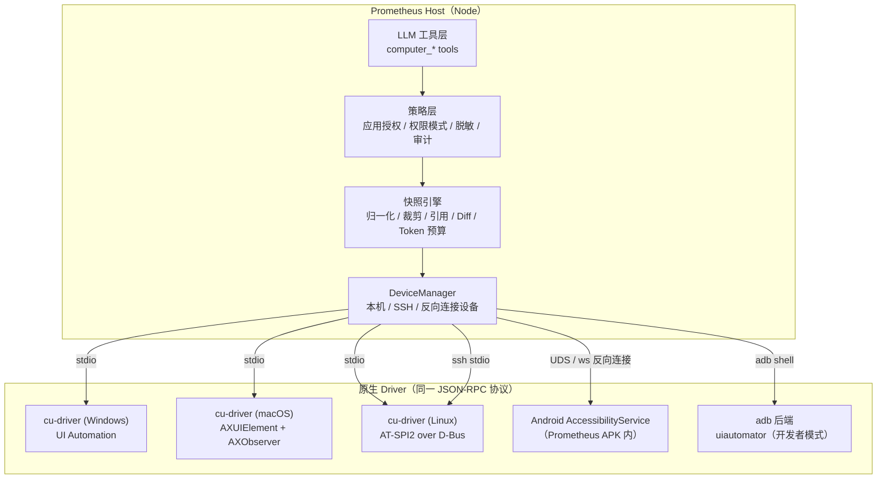

# Computer Use 插件设计

> 状态：v0.3 · **Windows / macOS / Linux / Android（adb）已实现并通过端到端测试**，位于 `plugins/computer-use`（见 §11、§12）· 目标：在 Windows / macOS / Linux / Android 上让 Agent 像 Codex Computer Use 一样操作本机应用，默认不依赖截屏。

---

## 1. 目标与原则

| # | 要求 | 设计回应 |
|---|------|----------|
| 1 | 达到 Codex 的体验 | 按应用授权、后台语义操作（不抢鼠标）、操作后返回增量变化、结果可验证 |
| 2 | 不依赖截屏 | 主通道用**系统无障碍树**（UIA / AX / AT-SPI / AccessibilityService），模型读的是结构化文本；截图只是最后的兜底，且可以关闭 |
| 3 | 四端支持 | 只有一套与平台无关的工具和快照引擎（TypeScript），平台差异全部放在原生 **Driver** 里，Driver 之间用同一个 JSON-RPC 协议 |
| 4 | 符合 Prometheus 插件体系 | 作为 `plugins/computer-use` 工作区插件，通过 `ctx.extension` 注册工具，用 `ctx.panel` 提供授权和审计页面，Driver 由工具商店（`runtimes.json`）分发 |
| 5 | 安全 | 和权限模式联动，按应用白名单，密码框脱敏，全局急停，审计日志 |

**为什么不用截屏**：截屏 + 视觉模型的方式每一步都要上千 token，坐标点击容易出错，还要求模型支持视觉。无障碍树能直接给出控件的角色、名称、值、状态和可执行的动作，用 `invoke` / `setValue` 操作，不需要猜坐标，大多数情况下也不需要把窗口切到前台。

**不做的事**：不做游戏或画布类应用的像素级自动化；不做绕过系统权限弹窗的操作；不做无人值守的远程控制木马式能力（远程设备必须由用户在设备端主动配对）。

---

## 2. 总体架构



分三层：

1. **工具层**：给模型用的工具不超过 7 个，参数小，返回纯文本。
2. **快照引擎**：把各平台的无障碍树统一成同一种角色模型，裁剪成精简的文本，分配稳定的元素引用，并在每次操作后计算增量变化。这一层是体验好坏的关键。
3. **Driver**：每个平台一个原生进程，只负责枚举、读取、执行动作和推送事件，不做任何策略判断。

---

## 3. 工具设计（LLM 视角）

| 工具 | 作用 | 关键参数 |
|------|------|----------|
| `computer_apps` | 列出正在运行的应用和窗口，也可以启动应用或打开 URL/文件 | `device?`, `launch?` |
| `computer_observe` | 取得目标窗口的结构化快照 | `app` / `window`, `scope?`（ref 子树）, `query?`（按文本/角色过滤）, `maxTokens?` |
| `computer_act` | 按引用执行一个或一批动作，返回增量变化 | `actions: [{ref, op, value?}]`, `settle?` |
| `computer_find` | 在不展开全树的情况下按名称、角色、文本查找元素 | `text`, `role?` |
| `computer_wait` | 等待某个条件成立（元素出现/消失、值改变、窗口出现） | `until`, `timeoutMs` |
| `computer_keys` | 发送快捷键或原始按键（兜底，需要焦点） | `keys: "ctrl+s"` |
| `computer_screenshot` | **兜底，默认关闭**：OCR 文本层，或把图片发给模型 | `mode: "ocr" \| "image"` |

`op` 的取值（跨平台统一）：`click`（优先语义 invoke）、`double_click`、`right_click`、`focus`、`set_value`、`type`（逐字输入）、`clear`、`toggle`、`select`、`expand`、`collapse`、`scroll`（`up/down/left/right/into_view`）、`drag_to`（目标 ref）、`back`/`home`/`recents`（Android）。

### 3.1 快照格式

用缩进文本，不用 JSON（大约能省 40% token），每行一个元素：

```
app 记事本 pid=8812 · window "无标题 - 记事本" [focused]
[w1] window "无标题 - 记事本"
  [e2] menubar
    [e3] menuitem "文件" ▸
    [e4] menuitem "编辑" ▸
  [e5] document "文本编辑器" value="hello wor…(1.2k)" editable focused
  [e6] statusbar "第 1 行，第 12 列"
  [e7] button "关闭"
(折叠 23 个无名容器 · 2 个列表项超出预算，用 scope=e9 展开)
```

规则：

- **裁剪**：去掉不可见、离屏、零尺寸元素；没有名称且只有一个子节点的容器直接压平；纯装饰元素不输出。
- **截断**：长值只保留开头，并标出总长度；长列表只输出前 N 项和 "还有 K 项"，模型可以用 `scope` 或 `query` 继续深入。
- **预算**：默认每次快照最多 2k token。超出时按以下优先级保留：焦点路径 > 可交互元素 > 带文本的元素 > 容器。
- **脱敏**：密码框（`IsPassword` / `AXSecureTextField` / `isPassword()` / `ROLE_PASSWORD_TEXT`）的值永远显示为 `••••`。

### 3.2 稳定引用

引用 `eN` 由 Driver 维护：`ref → 原生句柄 + 指纹`。指纹的组成是 `(role, name, automationId/identifier/resource-id, 在父节点中的位置, 祖先路径哈希)`。

- 原生句柄失效时（窗口重绘、列表虚拟化），用指纹重新定位；有多个候选时报错 `stale_ref`，并附上最新的局部快照。
- 同一窗口的连续快照中，没变化的元素沿用原来的 ref，这样模型的上下文不会失效。

### 3.3 操作后的增量变化（Codex 体验的核心）

`computer_act` 执行后，Driver 通过事件订阅（UIA StructureChanged/PropertyChanged、AXObserver、AT-SPI `object:*` 信号、`AccessibilityEvent`）等待界面**稳定**（默认 300ms 内没有新事件，最长 3s），然后返回：

```
ok click e3
+ [e40] menu "文件"
+   [e41] menuitem "新建(N)  Ctrl+N"
+   [e42] menuitem "保存(S)  Ctrl+S"
~ [e5] document focused → (unfocused)
focus: e40
```

模型几乎每一步都不需要重新调用 `observe`，这也是减少轮次和 token 的主要手段。弹出新窗口或对话框时，自动附带它的快照。

### 3.4 系统提示注入

插件在 `before_agent_start` 中追加一段使用准则：先 `observe` 一次，然后按 ref 操作，以返回的增量为准；优先用 `set_value`/`click`，`keys` 和坐标只作兜底；涉及支付、发送、删除等不可逆操作前要先向用户确认。

---

## 4. Driver 协议

使用 JSON-RPC 2.0，按行分隔，经 stdio / UDS / WebSocket 传输。所有平台的 Driver 都实现同一组方法：

| 方法 | 说明 |
|------|------|
| `hello` → `{platform, version, capabilities[], permissions{}}` | 握手，报告能力（如 `background_input`、`ocr`、`events`）和权限状态 |
| `apps.list` / `apps.launch` / `windows.list` / `window.activate` | 应用和窗口管理 |
| `tree.snapshot {window, scope?, depth?, filter?}` | 返回归一化后的节点（裁剪交给 Host） |
| `tree.find {window, text, role?}` | 原生查询（UIA FindAll / AX 搜索），比全树快得多 |
| `node.act {ref, op, value?}` | 执行动作，返回 `{ok, method: "pattern" \| "message" \| "synthetic"}` |
| `events.subscribe {window}` → 通知 `events.batch` | 推送结构和属性变化 |
| `input.keys` / `input.pointer` | 合成输入兜底 |
| `screen.ocr {window}` / `screen.capture` | 兜底视觉通道（可选能力） |

归一化节点：

```ts
interface CUNode {
  ref: string; role: Role; name?: string; value?: string; description?: string;
  states: ("focused"|"disabled"|"checked"|"selected"|"expanded"|"collapsed"|"editable"|"password"|"offscreen")[];
  actions: Op[];                 // 该节点真正支持的动作
  bounds?: [x, y, w, h];         // 仅用于兜底点击和 OCR 对齐，不发给模型
  children?: CUNode[];
}
```

`Role` 是统一后的约 40 种角色（button、link、textbox、document、checkbox、radio、combobox、list、listitem、tree、treeitem、table、row、cell、tab、tablist、menu、menuitem、menubar、dialog、window、toolbar、slider、progressbar、image、text、group…），各平台各维护一张映射表。

---

## 5. 各平台实现

Driver 用 **Rust** 写成一个 crate（`crates/cu-driver`），按平台条件编译；Android 因为必须是 Java/Kotlin 的 `AccessibilityService`，单独用 Kotlin 实现。桌面二进制作为 Tauri sidecar 随应用打包，同时发布到工具商店，供纯 Server、TUI 和 SSH 远端使用。

### 5.1 Windows — UI Automation

- 绑定：`uiautomation` / `windows` crate，使用 `IUIAutomation` 和 CacheRequest 批量取属性（性能的关键，否则一棵树要几千次跨进程调用）。
- 读取：`ControlViewWalker`，取 `Name`、`ControlType`、`AutomationId`、`ValuePattern.Value`、`IsPassword`、`IsOffscreen`、`BoundingRectangle`。
- 动作映射：`click` → `InvokePattern` / `SelectionItemPattern.Select` / `TogglePattern` / `LegacyIAccessible.DoDefaultAction`；`set_value` → `ValuePattern.SetValue`；`expand` → `ExpandCollapsePattern`；`scroll` → `ScrollPattern` / `ScrollItemPattern.ScrollIntoView`。这些全部**不移动鼠标，也不需要窗口在前台**。
- 兜底顺序：`PostMessage(WM_CHAR/WM_KEYDOWN)` 发到目标 HWND（后台），然后才用 `SendInput`（需要前台，执行前先 `SetForegroundWindow`，并在界面上提示）。
- 事件：`AddStructureChangedEventHandler`、`AddPropertyChangedEventHandler`、`AddFocusChangedEventHandler`，运行在 MTA 线程。
- 坑：UIPI 规定低完整性进程无法操作管理员窗口，此时报 `elevation_required`；Chromium/Electron 收到 UIA 客户端请求后才会懒加载无障碍树，第一次快照需要重试一次。
- OCR 兜底：`Windows.Media.Ocr`，在本地完成。

### 5.2 macOS — Accessibility (AX)

- 绑定：`objc2` + `ApplicationServices` FFI（`AXUIElementCreateApplication`、`AXUIElementCopyMultipleAttributeValues` 批量读取）。
- 权限：辅助功能（TCC）。sidecar 由 Prometheus.app 启动，"负责进程"是 Prometheus，所以用户只需要给 Prometheus 授权一次。`hello` 时通过 `AXIsProcessTrustedWithOptions` 检查，未授权时在面板中引导用户打开系统设置。截图 / OCR 才需要"屏幕录制"权限，默认不申请。
- 动作：`AXPress`、`AXShowMenu`、`AXIncrement/Decrement`、`AXRaise`、设置 `kAXValueAttribute`/`kAXFocusedAttribute`/`kAXSelectedAttribute`，都可以在后台执行。
- 后台按键：`CGEventPostToPid` 定向投递给目标进程，不影响用户当前的前台应用（Codex 后台操作的关键手段）。
- 事件：每个目标应用一个 `AXObserver`（`kAXValueChangedNotification`、`kAXCreatedNotification`、`kAXUIElementDestroyedNotification`、`kAXFocusedUIElementChangedNotification`），放在 Driver 的 CFRunLoop 线程里。
- 坑：Electron/Chrome 需要设置 `AXManualAccessibility = true` 才会暴露完整的树；部分应用的 `AXChildren` 很大，必须按深度和数量限流。
- OCR 兜底：Vision `VNRecognizeTextRequest`。

### 5.3 Linux — AT-SPI2

- 绑定：`atspi` crate（zbus），连接无障碍总线（`org.a11y.Bus`）。
- 读取：`Accessible`（role/name/children/states），`Text`、`Value`、`Component`（bounds）。用 `GetTree`/Cache 接口批量拉取。
- 动作：`Action.DoAction`（click/activate/press）、`EditableText.SetTextContents`、`Value.SetCurrentValue`、`Selection`、`Component.GrabFocus`，基本都能在后台执行。
- 前置条件：GTK3/4 默认开启；Qt 需要 `QT_ACCESSIBILITY=1`；Electron 需要 `--force-renderer-accessibility`。Driver 的 `hello` 检测 `org.a11y.Status.IsEnabled`，未开启时提示用户并可以一键开启 `gsettings set org.gnome.desktop.interface toolkit-accessibility true`。
- 合成输入兜底：X11 用 XTest；Wayland 用 `xdg-desktop-portal` RemoteDesktop（首次需要用户在系统弹窗中同意）或 `libei`；都不可用时报 `input_unavailable`，不尝试 `uinput` 提权。
- 无界面服务器：可以选择在 `Xvfb` + 独立会话中运行目标应用，Agent 在虚拟显示器中操作，完全不打扰用户（为以后的"沙箱桌面"预留）。
- OCR 兜底：可选依赖 `tesseract`，没有安装时报告该能力不可用。

### 5.4 Android — AccessibilityService

Android 只有两种可行的方式，两种都支持：

**A. APK 内置 AccessibilityService（主路径）**

- 在 Prometheus APK 中加入 `PrometheusAccessibilityService`（Kotlin），用户在 系统设置 → 无障碍 中手动开启（系统强制要求，无法绕过）。
- 读取：`getWindows()` + `AccessibilityNodeInfo` 遍历，取 `className`、`text`、`contentDescription`、`viewIdResourceName`、`isPassword`、`isEditable`、`getBoundsInScreen`。
- 动作：`performAction(ACTION_CLICK / ACTION_LONG_CLICK / ACTION_SET_TEXT / ACTION_SCROLL_FORWARD / ACTION_SCROLL_BACKWARD / ACTION_FOCUS / ACTION_SELECT / ACTION_EXPAND)`；`performGlobalAction(GLOBAL_ACTION_BACK / HOME / RECENTS / NOTIFICATIONS)`；兜底用 `dispatchGesture` 按 bounds 点击或滑动。
- 事件：`onAccessibilityEvent`（`TYPE_WINDOW_STATE_CHANGED`、`TYPE_WINDOW_CONTENT_CHANGED`、`TYPE_VIEW_TEXT_CHANGED`），用于计算稳定时机。
- 通道：
  - **本机模式**（APK 内置 Node Server）：Service 监听 abstract UNIX socket `@prometheus-cu-<uid>`，并校验对端 uid 必须是本应用，再加一次性 token，Node 端作为普通 Driver 连接。
  - **瘦客户端模式**（连接远程 Server）：用户在手机上点击"允许此服务器操作本机"，Service 经过现有 WebSocket 反向注册为设备 `android:<型号>`，Server 端通过 DeviceManager 转发 RPC。断开连接或关闭开关后立即失效。
- 发版注意：Google Play 对无障碍 API 有专门的政策审核，需要在声明中说明用途，并在应用内显示醒目的披露说明；GitHub 发布的 APK 不受此限制。
- 截图兜底：`AccessibilityService.takeScreenshot`（API 30+），默认关闭；OCR 用 ML Kit（可选的独立模块，避免 APK 体积暴涨）。

**B. adb 后端（开发者模式，不需要安装任何东西）**

- 从桌面端控制一台通过 USB / 无线调试连接的手机：`adb exec-out uiautomator dump /dev/tty` 取 XML 树，`input tap/text/keyevent` 执行操作。
- 缺点：每次 dump 需要 1–2s、没有事件，`input text` 不支持中文（需要配合 ADBKeyboard）。适合测试和自动化场景，作为次要路径。

### 5.5 能力矩阵

| 能力 | Windows | macOS | Linux X11 | Linux Wayland | Android |
|------|---------|-------|-----------|---------------|---------|
| 结构化树 | UIA ✅ | AX ✅ | AT-SPI ✅ | AT-SPI ✅ | A11yService ✅ |
| 后台语义动作 | ✅ | ✅ | ✅ | ✅ | ✅ |
| 后台按键 | PostMessage（部分） | CGEventPostToPid ✅ | XTest（需要焦点） | ❌ | ACTION_SET_TEXT ✅ |
| 变化事件 | ✅ | ✅ | ✅ | ✅ | ✅ |
| 合成指针 | SendInput | CGEvent | XTest | Portal / libei | dispatchGesture |
| 本地 OCR | Windows.Media.Ocr | Vision | tesseract（可选） | tesseract（可选） | ML Kit（可选） |

---

## 6. "不依赖截屏"的兜底阶梯

当无障碍树不够用时（自绘 UI、Canvas、游戏、远程桌面、Java Swing 没开 Access Bridge、部分 Flutter 应用），按以下顺序逐级降级，每一级都要在工具结果中写明"当前使用的是降级通道"：

1. **原生无障碍树**（默认）。
2. **框架专用通道**：Chromium 系应用如果开启了远程调试端口，就用 CDP `Accessibility.getFullAXTree` / DOM（与浏览器自动化共享实现）；Java 应用使用 Java Access Bridge。
3. **本地 OCR 伪元素**：在本机识别文字和坐标，生成 `[o12] text "确定" (ocr)` 这样的元素，可以用 ref 点击（坐标点击）。**图片不离开本机，也不发给模型**。
4. **截图发给模型**：只有当用户在设置中打开"允许发送截图"、且当前模型支持视觉输入时才可用；图片缩到长边 1280px，并叠加元素编号（Set-of-Mark），让模型仍然可以用 ref 操作。

---

## 7. 安全与权限

和 Codex 一样，**按应用授权**，并接入 Prometheus 现有的权限模式：

| 模式 | 行为 |
|------|------|
| plan | 只允许 `apps` / `observe` / `find`，禁止一切动作 |
| default | 每个会话第一次操作某个应用时弹窗确认（允许一次 / 本会话 / 始终允许该应用）；不可逆动作（命中"发送/支付/删除/提交"等语义的按钮）单独确认 |
| accept edits | 白名单内的应用不再询问，不可逆动作仍然要确认 |
| bypass | 白名单内全部放行；**拒绝名单永远生效** |
| 自动化（无人值守） | 只有 `access: full` 才能使用，并且只能操作预先加入白名单的应用，永远不会弹窗 |

其他措施：

- **拒绝名单（默认）**：密码管理器、系统钥匙串和凭据管理器、系统安全和隐私设置、UAC/sudo 提权对话框、Prometheus 自身窗口（防止 Agent 修改自己的权限）。
- **脱敏**：密码框只能写不能读，往密码框写入前必须确认；快照中匹配到疑似密钥、验证码的值会被打码。
- **急停**：全局热键（默认 `Ctrl/Cmd+Shift+Esc`，可以修改）和托盘/状态栏按钮会立即中止当前工具调用并暂停该会话的 Computer Use；Android 上使用常驻通知中的"停止"按钮。
- **可见性**：Agent 操作期间，托盘图标切换状态，目标窗口显示细边框高亮（Windows/macOS 用透明置顶窗口实现，不截屏）。
- **审计**：每个动作记录为 `{time, session, device, app, ref指纹, op, 是否脱敏}`，保存到 `<home>/plugin-data/computer-use/audit.jsonl`，可以在面板中查看。
- **远程设备**：只能由设备端发起配对（扫码或输入一次性码），Server 不能主动连接设备；配对凭证可以在两端随时撤销。

---

## 8. 插件结构

```
plugins/computer-use/
├─ package.json
├─ src/
│  ├─ index.ts            # definePlugin：注册工具、提示注入、面板、RPC
│  ├─ tools.ts            # computer_* 工具定义（TypeBox）
│  ├─ engine/
│  │  ├─ normalize.ts     # 平台角色 → 统一 Role
│  │  ├─ render.ts        # 节点树 → 缩进文本，预算与裁剪
│  │  ├─ diff.ts          # 快照增量
│  │  └─ redact.ts
│  ├─ policy.ts           # 应用授权、拒绝名单、不可逆动作识别
│  ├─ devices/
│  │  ├─ manager.ts       # 设备注册、选择、心跳
│  │  ├─ stdio.ts         # 本机 sidecar / ssh stdio
│  │  ├─ socket.ts        # Android UDS / 反向 WebSocket
│  │  └─ adb.ts           # uiautomator 后端
│  ├─ audit.ts
│  └─ panel/              # 授权管理、设备列表、审计、权限自检页面
└─ test/                  # 快照引擎的金样测试（各平台录制的树 fixture）

crates/cu-driver/          # Rust：win.rs / mac.rs / linux.rs + 协议
apps/desktop/src-tauri/gen/android/.../PrometheusAccessibilityService.kt
```

设置（`pluginSettings["computer-use"]`）：`allowScreenshots`、`ocr`、`snapshotTokenBudget`、`settleMs`、`killHotkey`、`apps.allow[]`、`apps.deny[]`。

TUI：工具一样可用；授权确认使用 `ctx.ui.confirm`；面板功能用 `/computer` 命令代替。

---

## 9. 里程碑

| 阶段 | 内容 | 验收 |
|------|------|------|
| M0 | 协议、快照引擎、工具层、Windows UIA Driver、策略和审计 | 记事本写入并保存文件；在系统设置中切换深色模式；全程不截屏 |
| M1 | macOS AX Driver、后台按键、权限引导 | 备忘录、Finder 重命名、在后台操作时用户能正常使用其他应用 |
| M2 | Linux AT-SPI Driver（GNOME/KDE，X11 + Wayland）、SSH 远端 Driver | gedit/Files 任务；通过 SSH 操作另一台机器 |
| M3 | Android AccessibilityService（本机 + 反向连接）、adb 后端 | 在设置中打开 Wi-Fi，在任意 IM 中输入中文草稿（不发送） |
| M4 | OCR 伪元素、CDP 通道、Set-of-Mark 截图兜底 | 自绘 UI 用例通过且图片不出本机 |
| M5 | 评测集：每个平台 30 个任务，记录成功率、步数、token、耗时，作为回归基线 | 平均每任务 token 比"截图 + 视觉"方案低 5 倍以上 |

---

## 10. 决策模型（意图判断 / 元素选择）

一些小的判断交给外部的**决策模型**（分类器）通过 API 完成，例如"这个操作能不能撤销""用户说的是哪一个元素"。插件**不内置模型**：没有配置时只用规则，配置之后由规则和模型一起判断。

| 方式 | 配置 | 覆盖范围 |
|------|------|----------|
| `registry` | `/computer decider registry [provider/model]`；不写模型时，自动选一个可用的决策模型（优先 Laya / Julia / Kev / Jev / Clef） | 通过 PI 的 `ctx.modelRegistry.classify()` 调用：llama.cpp 路由上的决策模型（Laya 等，走 `/v1/systemone`）和聊天模型、TypeSafe Jev、Cloudflare Clef、OpenAI Decisions API。凭证复用 PI 已有的 |
| `gateway` | `/computer decider gateway <网关id> <模型>` | Prometheus 中任意一个 `openai-completions` 格式的 AI 网关 |
| `openai` | `/computer decider openai <baseUrl> <模型> [API_KEY_ENV]` | 任意 OpenAI 兼容端点（vLLM、Ollama、LM Studio、llama-server…）。每个标签只占一个 token，概率从 logprobs 读取；服务端不支持 logprobs 时退回只读答案文本 |

用 `/computer decider test` 可以验证配置是否可用。配置保存在 `<home>/plugin-data/computer-use/settings.json`（仅所有者可读写）；也可以写在 `config.json` → `pluginSettings["computer-use"].decider`。

当前的用途：

1. **不可逆操作**：在规则没有命中的情况下，对 click / select / toggle 一个有名称的元素，以及在非聊天应用中按 Enter，询问模型（bool 问题），概率 ≥ 0.5 时要求用户确认。
2. **元素消歧**：`computer_find` 没有文本命中、或者多个候选同分时，让模型在最多 20 个候选中选一个（choice 问题）。

**安全约束**：模型只能让插件**更谨慎**，例如多问一次确认，但不能跳过规则要求的确认。原因是模型读到的界面文本来自任意应用和网页，可能被诱导。模型调用超时（8 秒）或出错时视为"没有意见"，由规则单独决定。

## 11. M0 实现记录（与设计稿的差异）

| 项目 | 设计稿 | M0 实际 | 原因 / 后续 |
|------|--------|---------|-------------|
| Windows Driver | Rust crate | C#（`drivers/windows/driver.cs`），首次使用时由 Windows PowerShell 的 `Add-Type` 调用 .NET Framework 自带的编译器编译，按源码哈希缓存 DLL | 不需要构建工具链，也不需要安装 .NET；任何 Windows 10/11 都能直接运行。协议不变，以后可以换成 Rust |
| 打包 | sidecar 二进制 | 驱动源码由 `pnpm --filter @prometheus/plugin-computer-use embed` 内联进 `src/driver/embedded.generated.ts`，运行时释放到 `plugin-data/computer-use/drivers/` | 与 modes 插件的资源内联方式一致，esbuild 打包后也能工作 |
| 稳定判定 | UIA 事件订阅 | 重复读取快照，直到连续两次的签名相同（`settleMs` 250，最长 `settleTimeoutMs` 3000） | 实现简单、跨平台通用；文件对话框这类大窗口会慢（实测 Ctrl+S 约 5.8s），M1 改为事件驱动 |
| 工具 | 7 个，含 screenshot | `computer_apps / observe / find / wait / act / keys / launch`；截图兜底推迟到 M4 | `launch` 单独拆成一个工具，这样 `computer_apps` 可以保持只读（plan 模式可用） |
| 权限 | 插件内按应用授权 | 沿用主机的权限门禁：只读工具（apps / observe / find / wait）带 `readOnlyHint`，plan 模式可用；act / keys / launch 在 default 模式下逐次询问。插件额外提供 `allowApps` / `denyApps`、内置拒绝名单、不可逆操作和密码框确认 | 不再另建一套重复的授权弹窗 |
| 急停 | 全局热键 | `/computer stop`（中止当前回合并暂停）/ `resume`，以及 RPC `pause` / `resume` 供后续面板使用 | 全局热键需要 Tauri 侧配合，放到 M1 |
| 运行模式识别 | — | 从系统提示中识别 auto / unattended：auto 模式不确认；无人值守运行拒绝不可逆操作（除非开启 `allowIrreversibleUnattended`） | |

验证：`plugins/computer-use/test` 有 27 个单元测试（快照引擎、diff、脱敏、策略、决策模型的三种后端、用假驱动测试的服务流程）。`scripts/e2e-notepad.ts` 是真机验收脚本：启动记事本 → 写入中英文 → Ctrl+S → 在另存为对话框中填写路径并点保存 → 校验文件内容 → 关闭。全程没有截屏，结果 PASS。

## 12. 多平台实现记录

四个平台都走同一套 JSON-RPC 协议和同一个快照引擎。热加载的内容（驱动源码）由 `pnpm --filter @prometheus/plugin-computer-use embed` 内联。

| 平台 | 驱动 | 验证方式 | 结果 |
|------|------|----------|------|
| Windows | C# + UI Automation，由 PowerShell `Add-Type` 编译 | 本机记事本：写入、另存为、校验文件 | PASS |
| macOS | Swift + AXUIElement / AXObserver，首次使用由 `swiftc` 编译并缓存（也支持 `PROMETHEUS_CU_DRIVER` 指向预编译二进制） | GitHub Actions `macos-latest`（macOS 26）上的 TextEdit：设置值、在光标处插入、读回中文 | PASS |
| Linux | Python + AT-SPI2（`python3-gi`） | GitHub Actions `ubuntu-24.04` + Xvfb，gedit | PASS |
| Android | `adb` + `uiautomator dump` / `input`（`src/driver/adb.ts`） | GitHub Actions Android 14 模拟器，设置应用：启动、读取、点击「网络和互联网」、返回 | PASS |

macOS 的做法：

- 点击、设置值、展开、滚动都用 AX 动作和属性，不移动用户的鼠标，也不把应用切到前台；只有最后兜底的合成点击才会激活窗口，并把鼠标放回原位。
- 按键用 `CGEvent.postToPid` 直接投递给目标进程，用户可以继续用自己的应用。`ctrl` 在 macOS 上按 Command 处理（与其他平台的习惯一致），需要真正的 Control 键写 `control`。
- 稳定判定用 AXObserver 事件（`ui.settle`）；没有事件能力的驱动仍然由主机轮询。Chromium / Electron 会自动打开 `AXManualAccessibility`。
- 菜单栏作为窗口树的子树返回（默认折叠，`scope=<ref>` 展开）。
- 权限：需要给启动驱动的应用（Prometheus 或终端）授予「辅助功能」。未授权时驱动会弹出系统提示，并返回 `permission_denied` 和具体的设置路径。

Linux 的限制：Wayland 不允许合成按键和指针，驱动会明确报 `input_blocked`，元素操作（点击 / 设置值 / 插入文本）仍然可用。

Android 的限制（adb 后端）：每次读取 1–2 秒；没有变化事件；`input text` 不支持中文，需要在手机上装并启用 ADB Keyboard；密码框的文本不会出现在名称或值里。用「设置 → computer-use → `device: "adb"`」切换（可选 `adbPath`、`adbSerial`）。**仍未实现**：Prometheus APK 内的 AccessibilityService（不需要 adb、有事件、支持中文输入），以及手机反向连接服务器。

## 13. 待决问题

1. 是否需要"沙箱桌面"（Windows 独立 Desktop / Linux Xvfb / macOS 无官方方案），让 Agent 在完全隔离的环境中运行？建议放到 M5 之后。
2. Driver 发布方式：随安装包打包（体积约增加 3–5MB）还是首次使用时从工具商店下载？建议桌面端随包、Server/TUI 按需下载。
3. 不可逆动作的识别准确率：先用关键词加角色规则，后续可以考虑本地分类器。
4. 多显示器、高 DPI 和缩放下的 bounds 换算（只影响兜底通道）。
